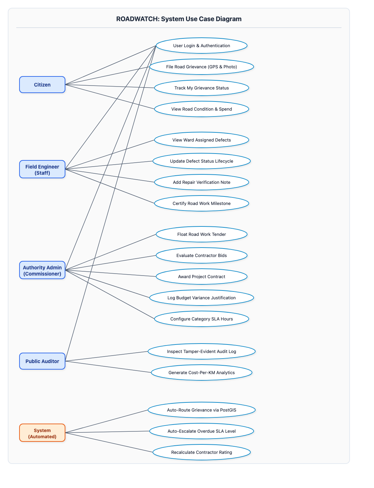
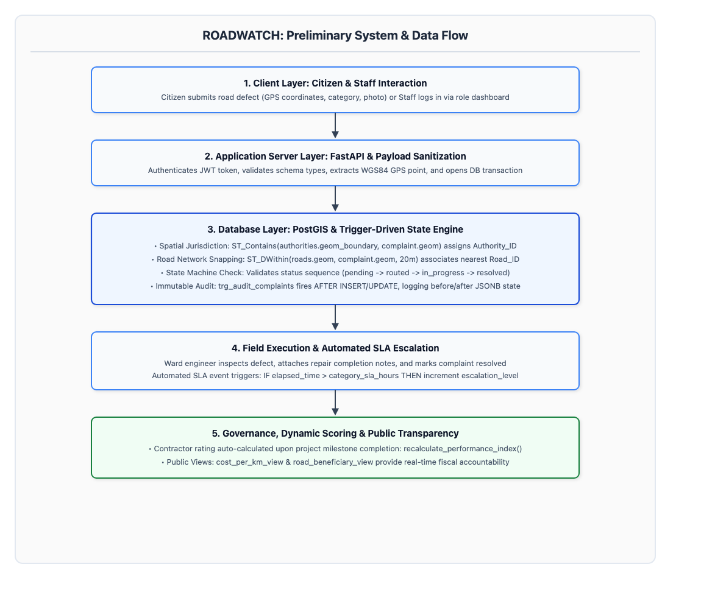

# Requirement Analysis Document (RAD)

**Software Requirements Specification & System Analysis for the Database Management System (DBMS) Project.**

---

## 1. Project Title & Metadata

* **Project Title:** ROADWATCH — Civic Infrastructure Intelligence & Road Grievance Governance Platform  
* **Subject:** Database Management Systems Laboratory (DBMS)  
* **Academic Year:** 2026–2027  
* **Team Members:**
  * **Kanak Waradkar** | **Roll No:** `24B-CO-030` | **Email:** kanakwaradkar@gmail.com *(Team Lead)*
  * **Krushna Surve** | **Roll No:** `24B-CO-031` | **Email:** krushnasurve07@gmail.com
  * **Manjunath Subhash Gavada** | **Roll No:** `24B-CO-035` | **Email:** manjunathgavada40@gmail.com

---

## 2. Introduction & Background

Urban road transportation infrastructure constitutes one of the largest capital investments managed by municipal governments and state public works agencies. Despite continuous public fund expenditures, road deterioration remains pervasive across urban clusters, marked by recurring potholes, waterlogging, surface erosion, and structurally compromised pavements. 

A primary root cause of this infrastructure crisis is administrative and technological fragmentation. Information regarding road assets, municipal tender contracts, contractor past performance, and citizen complaints is typically spread across uncoordinated operational silos. Field inspectors, administrative commissioners, and citizens have neither a unified visual ledger of road assets nor an accountable audit mechanism.

The **ROADWATCH DBMS** project is designed to eliminate these operational barriers. It provides an enterprise relational and geospatial database foundation engineered to store, correlate, and track the complete lifecycle of road infrastructure: from initial procurement tenders and contractor selection, through spatial defect registration and automated SLA escalation, to financial milestone disbursement and immutable audit tracking.

---

## 3. Problem Statement & Need for the System

Traditional municipal road grievance and maintenance mechanisms suffer from four structural vulnerabilities:

1. **Absence of Centralized Asset & Defect Registry:** Road segments and citizen complaints lack standardized relational representations with spatial coordinate anchoring, leading to duplicate records, unverified coordinates, and inaccurate defect prioritization.
2. **Disconnected Contractor Accountability:** Municipalities routinely award new road contracts without dynamic visibility into a vendor's historical project delivery performance, average delay days, or unresolved defect count.
3. **Manual, Error-Prone Grievance Routing:** Citizen grievances are manually handled by administrative clerks, frequently causing complaints to be misrouted across overlapping administrative boundaries (e.g., National Highways vs. State PWD vs. Municipal Corporation wards).
4. **Lack of Database-Level Integrity & Escalation:** In existing workflows, business constraints and status changes are loosely enforced in superficial application code. If a staff member ignores a critical defect or manually alters a record without logging, the system provides zero tamper evidence and zero automatic escalation.

**Need for the System:** A modern municipal infrastructure database must enforce relational integrity, spatial indexing, automated lifecycle triggers, and tamper-evident audit logging at the database engine tier, guaranteeing that operational policies execute deterministically regardless of external client applications.

---

## 4. Project Objectives

1. **To Design a Normalized Relational & Geospatial Schema:** Develop a 3NF/BCNF relational database incorporating OpenGIS spatial types (`Point`, `LineString`, `Polygon`) modeling road networks, administrative authorities, contractors, tenders, and grievances.
2. **To Implement a Database-Enforced State Machine:** Formulate database triggers and domain constraints that regulate grievance status transitions (`pending` → `routed` → `in_progress` → `resolved`/`rejected`) and disallow illegal lifecycle skips.
3. **To Automate Spatial Association & Jurisdiction Matching:** Utilize PostGIS topological functions (`ST_Contains`, `ST_DWithin`) within stored functions to automatically bind a defect to its parent administrative authority and nearest monitored road segment.
4. **To Build Dynamic Trigger-Driven Performance Metrics:** Implement database triggers that compute contractor ratings (`performance_index`) and track project delays immediately upon milestone completion or contract closeout.
5. **To Establish an Immutable, Tamper-Evident Audit Trail:** Capture all insert, update, and delete actions on critical operational tables within a centralized, append-only `audit_log` table storing before/after JSONB payloads, actor identity, and system timestamps.
6. **To Maximize Spatial and Relational Query Performance:** Implement GiST (Generalized Search Tree) spatial indexing and composite B-tree indexing to ensure sub-millisecond retrieval of road segments, nearby grievances, and contractor scorecards under heavy concurrency.

---

## 5. Functional Requirements

| FR ID | Requirement Statement | Target Actors | Database Tables / Entities |
| :--- | :--- | :--- | :--- |
| **FR1** | The system shall authenticate citizens, field engineers, authority admins, and auditors using secure credentials and role designations. | All Users | `Citizen`, `Authority`, `Staff` |
| **FR2** | The system shall allow citizens to register road complaints with GPS coordinates, title, description, category, and an optional image URL. | Citizen | `Complaint`, `Citizen` |
| **FR3** | The system shall automatically resolve the governing municipal authority by determining which administrative polygon contains the complaint coordinates (`ST_Contains`). | System (Automated) | `Complaint`, `Authority` |
| **FR4** | The system shall snap the reported grievance to the nearest monitored road segment within a defined spatial proximity radius (`ST_DWithin`). | System (Automated) | `Complaint`, `Road` |
| **FR5** | The system shall restrict citizens to viewing the detailed progression, status changes, and resolution notes only for complaints filed by their own account. | Citizen | `Complaint`, `Citizen` |
| **FR6** | The system shall enable ward engineers to inspect grievances assigned to their jurisdiction and transition status to `in_progress`. | Field Staff | `Complaint`, `Authority` |
| **FR7** | The system shall require field engineers to append mandatory verification notes and resolution timestamp when closing a complaint as `resolved`. | Field Staff | `Complaint`, `Status_History` |
| **FR8** | The system shall disallow illegal complaint status skips (e.g., jumping from `pending` directly to `resolved`) via a database-level trigger validation function. | System (Automated) | `Complaint`, `Status_History` |
| **FR9** | The system shall automatically detect SLA breaches and increment the escalation level (`escalation_level` 0 → 1 → 2) once open duration exceeds category SLA hours. | System (Automated) | `Complaint`, `SLA_Config`, `SLA_Escalation` |
| **FR10** | The system shall record an audit record in `audit_log` whenever an update or delete occurs on complaints, projects, roads, or contractor tables. | System (Automated) | `Audit_Log` |
| **FR11** | The system shall allow authority administrators to float public tenders with estimated budgets, requirements, and bidding deadlines. | Admin | `Tender`, `Authority` |
| **FR12** | The system shall record contractor bids for active tenders, evaluating financial quotes and technical qualification scores. | Admin, Contractor | `Tender_Bid`, `Contractor`, `Tender` |
| **FR13** | The system shall allow administrators to approve or log budget variance justifications when actual project spending exceeds allocated contract funds. | Admin | `Project`, `Budget_Variance_Reason` |
| **FR14** | The system shall automatically recompute a contractor’s `performance_index` via trigger whenever a linked project completes or logs delay days. | System (Automated) | `Contractor`, `Project` |
| **FR15** | The system shall track milestone-based payment disbursements for road works, validating completion verification before fund release. | Admin, Staff | `Project_Milestone`, `Project` |
| **FR16** | The system shall provide analytical views summarizing road condition indices, average resolution time, contractor rankings, and public cost-per-kilometer. | All Roles / Auditor | `Road`, `Project`, `Complaint`, Views |

---

## 6. User Roles and Permissions Matrix

The database defines four granular user profiles with role-specific views and execution permissions:

| Permission / Operation | Citizen | Field Staff / Ward Engineer | Authority Admin (Commissioner) | Auditor / Public Oversight |
| :--- | :---: | :---: | :---: | :---: |
| **File Grievance with GPS & Photo** | Permitted | Restricted | Restricted | Restricted |
| **View Own Complaints & Timeline** | Full Access | Restricted | Ward Access | Read-Only View |
| **Inspect Jurisdiction Complaints** | Restricted | Ward Access | Full Access | Read-Only View |
| **Update Complaint Status & Notes** | Restricted | Trigger Validated | Full Access | Restricted |
| **Float Tenders & Award Contracts** | Restricted | Restricted | Full Access | Restricted |
| **Submit Tender Bids** | Restricted | Restricted | Restricted (Vendors) | Restricted |
| **Approve Budget Variances & Milestones**| Restricted | Restricted | Full Access | Restricted |
| **Configure Department SLAs** | Restricted | Restricted | Full Access | Restricted |
| **Inspect Immutable Audit Trail (`audit_log`)**| Restricted | Restricted | Full Access | Dedicated View |
| **View Public Scorecards & Cost/KM** | Public Access | Public Access | Full Access | Dedicated View |

---

## 7. Major System Modules

```
┌────────────────────────────────────────────────────────────────────────┐
│                        ROADWATCH DBMS PLATFORM                         │
└──────────────────────────────────┬─────────────────────────────────────┘
                                   │
         ┌─────────────────────────┼─────────────────────────┐
         ▼                         ▼                         ▼
┌──────────────────┐      ┌──────────────────┐      ┌──────────────────┐
│  Asset & Spatial │      │   Grievance &    │      │  Procurement &   │
│  Infrastructure  │      │    Lifecycle     │      │   Contractor     │
│  Module          │      │    Module        │      │   Module         │
└──────────────────┘      └──────────────────┘      └──────────────────┘
         │                         │                         │
         ├─────────────────────────┼─────────────────────────┤
         ▼                         ▼                         ▼
┌──────────────────┐      ┌──────────────────┐      ┌──────────────────┐
│  Fiscal & Budget │      │   SLA & Auto-    │      │  Audit Trail &   │
│  Governance      │      │   Escalation     │      │  Public Analytics│
│  Module          │      │   Module         │      │  Module          │
└──────────────────┘      └──────────────────┘      └──────────────────┘
```

1. **Asset & Spatial Infrastructure Module:** Maintains spatial definitions of road segments (`LineString`), surface materials, width, lane counts, and municipal jurisdiction boundaries (`Polygon`). Computes topological intersections and containment.
2. **Grievance & Lifecycle Module:** Handles registration, classification (`pothole`, `paving_defect`, `waterlogging`, `debris`, `missing_signage`), and status progression with trigger-enforced state machine checks.
3. **Geospatial Jurisdiction & Routing Module:** Automatically matches complaint coordinates to jurisdictional authorities and road segments using PostGIS indexed spatial algorithms (`ST_Contains`, `ST_DWithin`).
4. **Procurement & Contractor Governance Module:** Manages contractor licensing, tender publications, competitive bidding, contractor performance scorecards, and blacklisting registries.
5. **Fiscal & Budget Governance Module:** Governs capital allocation, milestone progress verification, contingency reserves, and formal budget variance justification trails.
6. **SLA & Automated Escalation Module:** Evaluates real-time grievance age against configured SLAs, executing automated priority escalation and departmental notifications upon SLA breach.
7. **Audit Trail & Governance Module:** Transparently logs before/after snapshots of mutated rows, executing database user, and exact timestamp into an append-only audit repository.
8. **Public Analytics & Reporting Module:** Provides pre-aggregated database views calculating cost-per-kilometer, average resolution turnaround, contractor delay metrics, and recurrent defect heatmaps.

---

## 8. Use Cases & Use Case Diagram

### Use Case Specifications

| Use Case ID | Use Case Name | Primary Actor | Description | Precondition | Postcondition |
| :--- | :--- | :--- | :--- | :--- | :--- |
| **UC01** | User Authentication | Citizen / Staff / Admin | User logs into system with credentials. | Registered account exists. | Role-specific session created. |
| **UC02** | Submit Road Grievance | Citizen | Citizen logs defect with GPS point and photo. | Valid citizen session. | Complaint persisted, authority resolved. |
| **UC03** | Auto-Route Complaint | System (Automated) | Spatial trigger identifies authority & nearest road. | Complaint coordinate entered. | `assigned_authority_id` & `road_id` populated. |
| **UC04** | View My Grievances | Citizen | Citizen queries history of their own reports. | Citizen authenticated. | Only citizen's own records displayed. |
| **UC05** | Inspect & Accept Defect | Field Staff | Engineer verifies defect and marks `in_progress`.| Complaint assigned to staff's ward. | Status updated; audit row inserted. |
| **UC06** | Complete Repair & Close | Field Staff | Engineer attaches repair log and marks `resolved`. | Complaint in `in_progress` state. | Status set to `resolved`; duration logged. |
| **UC07** | Auto-Escalate Overdue | System (Automated) | System detects SLA breach and escalates level. | Complaint age > SLA threshold. | `escalation_level` raised; log recorded. |
| **UC08** | Float Public Tender | Authority Admin | Admin publishes road construction tender. | Road asset & budget approved. | Tender enters `published` state. |
| **UC09** | Submit Contractor Bid | Contractor | Contractor submits financial & technical proposal.| Tender in `bid_open` state. | Bid stored in `tender_bids`. |
| **UC10** | Award Tender & Project | Authority Admin | Admin selects winning bid and creates project. | Tender evaluation complete. | Project created; contractor assigned. |
| **UC11** | Approve Milestone | Authority Admin | Admin verifies milestone and releases payment. | Milestone inspection certified. | `project_milestones.status = 'completed'`.|
| **UC12** | Log Budget Variance | Authority Admin | Admin records revised budget and formal justification.| Spending exceeds initial allocation.| Record added to `budget_variance_reasons`.|
| **UC13** | Auto-Score Contractor | System (Automated) | Trigger calculates contractor `performance_index`. | Project marked completed/delayed. | Contractor scorecard updated. |
| **UC14** | Inspect System Audit Log | Auditor | Auditor reviews system mutations and timestamps. | Auditor credentials verified. | Append-only audit history presented. |

### Use Case Diagram



*Figure 1: UML Use Case Diagram illustrating role-based interactions across Citizens, Field Engineers, Authority Administrators, Public Auditors, and Automated Database Triggers.*

---

## 9. Data Requirements

*(Note: In accordance with standard DBMS design methodology, this section identifies information requirements without foreign key relational artifacts, which are formalized in the ERD and Relational Schema stages.)*

| Data Category | Conceptual Data Items Required |
| :--- | :--- |
| **Authority** | Identifier, Name, Department Code, Contact Email, Contact Phone, Geographic Jurisdiction Boundary (Polygon). |
| **Road Asset** | Identifier, Road Name, Highway/Road Code, Structural Condition Status, Length in KM, Road Classification Type, Surface Material, Lane Count, Spatial Geometry Path (LineString). |
| **Contractor** | Identifier, Contractor Code, Corporate Name, Registration License Number, Registration Date, Contact Email, Average Rating, Projects Completed Count, Projects Delayed Count, Blacklist Status, Derived Performance Index. |
| **Project (Contract)** | Identifier, Contract Title, Allocated Budget, Spent Budget, Execution Status, Planned Start Date, Target Completion Date, Actual Completion Date, Delay Days Count. |
| **Citizen** | Identifier, Citizen Name (First Name, Last Name), Email Address, Contact Phone Numbers (multivalued), Residential Ward Location. |
| **Complaint (Grievance)** | Identifier, Title, Problem Description, Defect Category, Spatial GPS Coordinate (Point), Lifecycle Status, Priority Level, Escalation Level, Photo URL, Created Timestamp, Updated Timestamp. |
| **Tender** | Identifier, Reference Number, Title, Detailed Description, Estimated Capital Value, Procurement Status, Publication Date, Bid Deadline Date, Award Date. |
| **Project Milestone** | Milestone Number (within Project), Milestone Title, Work Description, Allocation Amount, Milestone Status, Due Date, Actual Completion Date. *(Weak Entity)* |
| **Status History** | Sequence Number (within Complaint), Previous Status, New Transition Status, Updated Timestamp, Transition Remarks. *(Weak Entity)* |
| **SLA Policy** | Identifier, Defect Category, Maximum Resolution Hours, Escalation Threshold Level, Notification Template. |
| **Audit Event** | Event Identifier, Modified Table Name, Target Record Identifier, Mutation Action (INSERT/UPDATE/DELETE), Snapshot of Old Values (JSONB), Snapshot of New Values (JSONB), Acting User, Event Timestamp. |

---

## 10. Business Rules

1. **BR1 (Citizen Grievance Integrity):** Every complaint must be filed by exactly one registered citizen, must contain valid geographic point coordinates within the municipal boundary, and must fall into a pre-approved defect category.
2. **BR2 (Automated Spatial Ownership):** A complaint's governing authority is determined dynamically by geometric polygon containment (`ST_Contains(authorities.geom_boundary, complaints.geom)`); it cannot be manually assigned arbitrarily.
3. **BR3 (Strict State Transition Validation):** A complaint must transition sequentially through:  
   `pending` → `routed` → `in_progress` → `resolved` / `rejected`  
   Direct skips (such as `pending` directly to `resolved`) must be rejected by database triggers with an explicit SQL exception.
4. **BR4 (Mandatory Resolution Documentation):** Setting a complaint to `resolved` requires a non-empty repair explanation and timestamp.
5. **BR5 (Automated SLA Breach Escalation):** If an open complaint's elapsed duration exceeds the category SLA hours, the database must escalate its level (`0` → `1` → `2`) and record the escalation event in `sla_escalations`.
6. **BR6 (Contractor Bidding Eligibility):** A contractor currently marked as `blacklisted = TRUE` is strictly barred from submitting bids on active tenders.
7. **BR7 (Contract Date Sanity Constraint):** A project's `target_end_date` must be greater than or equal to its `start_date`. If provided, `actual_end_date` must also equal or exceed `start_date`.
8. **BR8 (Dynamic Contractor Score Calculation):** Whenever a project completes or logs delay days, the contractor's `performance_index` is automatically recalculated:  
   `performance_index = (projects_completed / max(projects_completed + projects_delayed, 1)) × rating × 20`
9. **BR9 (Milestone Payment Constraint):** A project milestone payment cannot be authorized unless the milestone status is certified as `completed`. Total milestone amounts must not exceed the project allocated budget.
10. **BR10 (Budget Variance Justification):** Any increase in project expenditures beyond `budget_allocated` requires a corresponding record in `budget_variance_reasons` documenting the variance amount, formal reason, and approving official.
11. **BR11 (Zero Unlogged Mutations):** Every INSERT, UPDATE, and DELETE on core tables (`complaints`, `projects`, `roads`, `contractors`) must execute an AFTER trigger logging complete before/after state to `audit_log`.
12. **BR12 (Administrative Deletion Restrictions):** Core infrastructure assets (Roads, Authorities) cannot be hard-deleted if active projects or open complaints reference them (`ON DELETE RESTRICT`).

---

## 11. Input Requirements

| Input Description | Submitted By | Input Format / Validation Rules | Target Purpose |
| :--- | :--- | :--- | :--- |
| **Citizen Registration** | Citizen | Name, valid email regex, 10-digit phone, residential ward. | Account creation & notification routing. |
| **Grievance Submission** | Citizen | Text title (max 255), description, category dropdown, GPS Point (WGS84 lat/lon), photo URL. | Defect registration and spatial matching. |
| **Defect Status Progression** | Field Staff | Enum: `['routed', 'in_progress', 'resolved', 'rejected']`, mandatory resolution text if resolved. | State machine progression. |
| **Public Tender Creation** | Authority Admin | Reference No (unique string), title, estimated amount (>0), published date, deadline (>= published date). | Initiating public procurement. |
| **Contractor Bid Submission** | Contractor | Financial quote (>0), technical score, contractor license validation. | Competitive procurement evaluation. |
| **Milestone Certification** | Field Staff / Admin | Milestone title, target due date, completion date, verification officer signature. | Payment release authorization. |
| **Budget Variance Request** | Authority Admin | Original budget, revised budget, positive variance amount, formal justification text, approval URL. | Fiscal accountability audit. |
| **SLA Configuration Threshold**| Authority Admin | Defect category, resolution timeout hours (integer > 0), escalation target authority ID. | Defining operational SLA policies. |

---

## 12. Output Requirements & Reports

| Output / Report Name | Intended Audience | Core Metrics & Information Displayed | Operational Value |
| :--- | :--- | :--- | :--- |
| **Citizen Complaint Tracker** | Citizen | Tracking ID, current status badge, nearest road name, assigned authority, elapsed time, photo preview. | Citizen transparency & trust. |
| **Ward Grievance Queue** | Field Staff | List of active defects within ward boundary, priority score, category, SLA countdown timer. | Prioritized daily field repair tasks. |
| **Overdue SLA Escalation Report**| Authority Admin | List of complaints exceeding SLA, days overdue, escalation tier (Level 1/2), failing department. | Administrative intervention & accountability. |
| **Contractor Performance Matrix**| Authority Admin | Contractor code, projects completed, delay days, average rating, calculated `performance_index`, blacklist flag. | Objective procurement award decisions. |
| **Project Cost-Per-KM View** | Public / Auditor | Project title, road name, length (km), budget allocated, budget spent, calculated allocated/spent per km, variance. | Detecting public expenditure inflation. |
| **Municipal Defect Trend Report**| Municipal Council | Monthly complaint count by category, repeat defect roads, seasonal pothole density overlays. | Long-term capital budgeting decisions. |
| **Tamper-Evident Audit Dossier** | State Auditor | Chronological log of table mutations, acting DB user, timestamp, JSON diff of modified attributes. | Forensic investigation of corruption or data tampering. |

---

## 13. System Constraints & Assumptions

1. **Database Platform Constraint:** The operational database must run on PostgreSQL 16+ with PostGIS 3.4+ installed and enabled.
2. **Spatial Coordinate Reference System:** All spatial geographic geometries must be projected in EPSG:4326 (WGS 84 latitude/longitude) for interoperability with GPS and OpenStreetMap.
3. **Spatial Proximity Radius:** Defect-to-road snapping is calibrated with a maximum default threshold of 20 meters (`ST_DWithin`); defects beyond 20 meters from any registered road segment are flagged for manual GIS alignment.
4. **Data Integrity Over Speed:** Strict referential integrity, foreign key cascading constraints, and audit trigger execution take precedence over asynchronous eventual consistency.
5. **Single Municipality / Regional Scalability:** The relational schema accommodates multi-region deployments via region codes (`regions`), but jurisdiction queries assume non-overlapping municipal authority polygons per region.
6. **Network Connectivity Assumption:** Field engineers and citizens operate with intermittent cellular networks; the application layer buffers submissions, but the database transactions execute with ACID guarantees upon reaching the server.
7. **Append-Only Audit Guarantee:** The `audit_log` table allows INSERT operations only; UPDATE and DELETE privileges on `audit_log` are revoked from general application users to prevent history alteration.

---

## 14. Proposed Technology Stack

| Layer | Technology | Version / Tooling | Architectural Responsibility |
| :--- | :--- | :--- | :--- |
| **Database Engine** | PostgreSQL + PostGIS | PostgreSQL 16.2 / PostGIS 3.4 | Primary relational data store, spatial geometry math, triggers, stored procedures, audit logging. |
| **Application Backend** | Python / FastAPI | Python 3.11, SQLAlchemy, Psycopg2 | Thin REST API gateway translating HTTP calls to parameterized SQL queries and executing stored procedures. |
| **Spatial Querying** | PostGIS Functions | `ST_Contains`, `ST_DWithin`, `ST_AsGeoJSON` | Real-time topological routing and proximity calculations. |
| **User Interface** | Next.js (React) | Next.js 16 App Router, TypeScript | Interactive responsive web application, Leaflet GIS map rendering, citizen reporting wizard. |
| **Styling & Motion** | Tailwind CSS / Framer | Tailwind CSS v4, Framer Motion | High-visibility accessible user interface, stateful animations. |
| **Development & Modeling**| Database Modeling | Draw.io, dbdiagram.io, EXPLAIN ANALYZE | Conceptual Chen ER modeling, schema mapping, query profiling. |

---

## 15. Preliminary System Flow



*Figure 2: Architectural and preliminary data flow pipeline from client submission through application validation, PostGIS spatial processing, trigger-driven state machine transition, automated SLA monitoring, and public transparency views.*

---

## 16. Traceability Matrix

This matrix establishes 100% bidirectional traceability between functional requirements, structural modules, and database tables:

| Requirement ID | System Module | Governing Database Table(s) | Primary Operation / Enforcement Mechanism |
| :--- | :--- | :--- | :--- |
| **FR1** | User Management | `Citizen`, `Authority`, `Staff` | Password hashing, role-based view filtering. |
| **FR2, FR5** | Grievance Management | `Complaint`, `Citizen` | `INSERT`, `SELECT` restricted by `citizen_id`. |
| **FR3, FR4** | Geospatial Jurisdiction | `Complaint`, `Authority`, `Road` | `ST_Contains` and `ST_DWithin` spatial trigger functions. |
| **FR6, FR7, FR8**| Lifecycle State Machine| `Complaint`, `Status_History` | `BEFORE UPDATE` trigger rejecting invalid transitions. |
| **FR9** | SLA & Escalation | `Complaint`, `SLA_Config`, `SLA_Escalations` | Scheduled evaluation trigger & `escalation_level` counter. |
| **FR10** | Governance & Audit | `Audit_Log` | `AFTER INSERT/UPDATE/DELETE` triggers on core tables. |
| **FR11, FR12** | Procurement & Tenders | `Tender`, `Tender_Bid`, `Contractor` | Foreign keys, unique reference numbers, bid scoring constraints. |
| **FR13, FR15** | Fiscal Governance | `Project`, `Project_Milestone`, `Budget_Variance_Reasons` | Domain check constraints, milestone verification checks. |
| **FR14** | Contractor Scoring | `Contractor`, `Project` | `trg_contractor_perf_index` calculating `performance_index`. |
| **FR16** | Public Analytics | Views (`cost_per_km_view`, `road_beneficiary_view`) | Aggregate relational queries calculating spending efficiency. |

---

## 17. Summary & Real-World Impact

The **ROADWATCH DBMS** replaces fragmented, unaccountable, and paper-dependent municipal road maintenance with a unified, trigger-driven relational and spatial database architecture. 

By enforcing grievance lifecycles, automated PostGIS jurisdiction routing, dynamic contractor performance scoring, and immutable audit trails directly at the database engine level, the platform guarantees systemic transparency. Public funds allocated to road repairs can be traced down to the exact kilometer, overdue grievances are escalated automatically without human bias, and blacklisted contractors are prevented from securing public contracts. This delivers a resilient, self-healing database backbone for smart cities.

---

## 18. Academic References

1. **Elmasri, R., & Navathe, S. B.** (2018). *Fundamentals of Database Systems* (7th ed.). Pearson Education.
2. **Silberschatz, A., Korth, H. F., & Sudarshan, S.** (2020). *Database System Concepts* (7th ed.). McGraw-Hill Education.
3. **Ramakrishnan, R., & Gehrke, J.** (2003). *Database Management Systems* (3rd ed.). McGraw-Hill Education.
4. **PostgreSQL Global Development Group.** (2024). *PostgreSQL 16 Documentation*. https://www.postgresql.org/docs/16/
5. **PostGIS Project Steering Committee.** (2024). *PostGIS 3.4 Spatial Database Manual*. https://postgis.net/documentation/
6. **ISO/IEC/IEEE 29148:2018.** *Systems and software engineering — Life cycle processes — Requirements engineering*. IEEE Standards Association.
