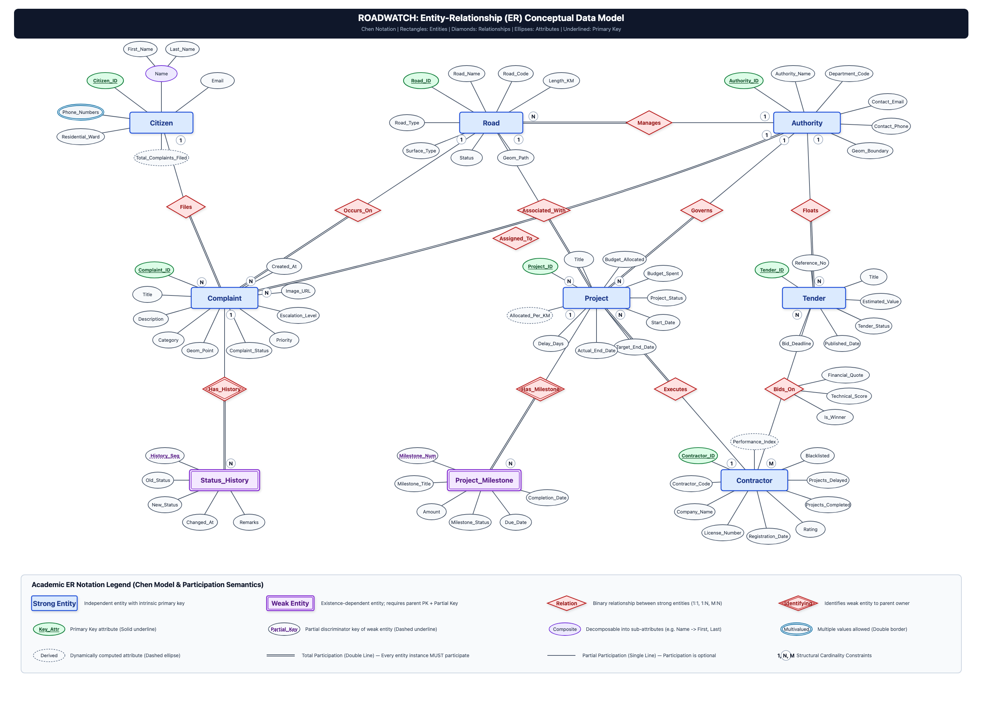

# Entity-Relationship (ER) Document & Relational Schema

**ROADWATCH — Civic Infrastructure Intelligence & Road Grievance Governance Platform**  
*Laboratory Submission: Phase 2 & Phase 3 (Conceptual & Logical Database Design)*

* **Member 1 (Team Lead):** Kanak Waradkar | **Roll No:** `24B-CO-030` | **Email:** kanakwaradkar@gmail.com  
* **Member 2:** Krushna Surve | **Roll No:** `24B-CO-031` | **Email:** krushnasurve07@gmail.com  
* **Member 3:** Manjunath Subhash Gavada | **Roll No:** `24B-CO-035` | **Email:** manjunathgavada40@gmail.com  

---

## Note on Conceptual ER Diagram Design Principles

The Entity-Relationship model adheres strictly to classical **Peter Chen conceptual modeling notation** (rectangles for entities, ellipses for attributes, and diamonds for relationships). In accordance with standard database engineering methodology (Elmasri & Navathe, Silberschatz):

* **Conceptual ER Diagram:** Associations are modeled exclusively through **relationship diamonds** connecting entities, with entities containing only their intrinsic attributes and primary keys. Foreign key attributes do not appear in the conceptual ER diagram.
* **Relational Schema:** Foreign keys materialize systematically during the subsequent **Logical Design & Relational Mapping phase** (Section 4) as a mathematical consequence of mapping 1:1, 1:N, and M:N relationships into normalized relations.

---

## 1. Entities and Attributes Specification

*Underlined attributes represent primary keys. Attribute types follow standard Chen ER notation: simple (plain ellipse), composite (branched ellipses), multivalued (double ellipse), derived (dashed ellipse), and partial key (dashed underline).*

### 1. Citizen (Strong Entity)
Represents registered residents submitting grievances and monitoring public road transparency.

| Attribute | Type | ER Representation | Notes / Semantic Definition |
| :--- | :--- | :--- | :--- |
| **Citizen_ID** | Simple, Key | Solid Underline | Unique primary key identifying a citizen. |
| **Name** | Composite | Sub-branches | Composed of **First_Name** and **Last_Name**. |
| **Email** | Simple | Plain Ellipse | Contact and authentication email address. |
| **Phone_Numbers**| Multivalued | **Double Ellipse** | A citizen may provide multiple contact telephone numbers. |
| **Residential_Ward**| Simple | Plain Ellipse | Municipal residential ward identifier. |
| **Total_Complaints_Filed**| Derived | **Dashed Ellipse** | Computed via `COUNT(*)` from `Complaint` entity. |

### 2. Authority (Strong Entity)
Represents municipal corporations, public works departments (PWD), or smart city administrative bodies.

| Attribute | Type | ER Representation | Notes / Semantic Definition |
| :--- | :--- | :--- | :--- |
| **Authority_ID** | Simple, Key | Solid Underline | Unique primary key identifying the authority. |
| **Authority_Name** | Simple | Plain Ellipse | Formal administrative title (e.g., *Panaji Municipal Corp*). |
| **Department_Code**| Simple | Plain Ellipse | Standard departmental code (e.g., `PWD-RD-01`). |
| **Contact_Email** | Simple | Plain Ellipse | Official departmental escalation email. |
| **Contact_Phone** | Simple | Plain Ellipse | Departmental helpline telephone number. |
| **Geom_Boundary** | Simple | Plain Ellipse | Spatial polygon representing jurisdiction area. |

### 3. Road (Strong Entity)
Represents physical road segments monitored and maintained within the infrastructure network.

| Attribute | Type | ER Representation | Notes / Semantic Definition |
| :--- | :--- | :--- | :--- |
| **Road_ID** | Simple, Key | Solid Underline | Unique primary key for the road segment. |
| **Road_Name** | Simple | Plain Ellipse | Common street or corridor name (e.g., *MG Road*). |
| **Road_Code** | Simple | Plain Ellipse | Official highway/arterial designation (e.g., `NH-66`, `SH-08`). |
| **Length_KM** | Simple | Plain Ellipse | Total segment length in kilometers (> 0.00). |
| **Road_Type** | Simple | Plain Ellipse | Classification category (`NH`, `SH`, `MDR`, `City`, `Urban`). |
| **Surface_Type**| Simple | Plain Ellipse | Surface composition (`asphalt`, `concrete`, `pavers`). |
| **Status** | Simple | Plain Ellipse | Current operational health (`good`, `fair`, `poor`, `under_construction`). |
| **Geom_Path** | Simple | Plain Ellipse | Spatial LineString representing geographic coordinates. |

### 4. Contractor (Strong Entity)
Represents certified engineering and construction companies bidding on and executing road contracts.

| Attribute | Type | ER Representation | Notes / Semantic Definition |
| :--- | :--- | :--- | :--- |
| **Contractor_ID** | Simple, Key | Solid Underline | Unique primary key for the contractor firm. |
| **Contractor_Code**| Simple | Plain Ellipse | Standard vendor registration code (e.g., `CON-00102`). |
| **Company_Name** | Simple | Plain Ellipse | Registered legal commercial firm name. |
| **License_Number**| Simple | Plain Ellipse | State government contractor license identifier. |
| **Registration_Date**| Simple | Plain Ellipse | Date of initial government accreditation. |
| **Rating** | Simple | Plain Ellipse | Average engineering inspection score (0.00 to 5.00). |
| **Projects_Completed**| Simple | Plain Ellipse | Count of successfully closed road contracts. |
| **Projects_Delayed**| Simple | Plain Ellipse | Count of projects exceeding target end date. |
| **Blacklisted** | Simple | Plain Ellipse | Boolean flag barring firm from submitting bids. |
| **Performance_Index**| Derived | **Dashed Ellipse** | Auto-computed composite score (0.00 to 100.00). |

### 5. Project (Strong Entity)
Represents sanctioned public works road construction or repair contracts.

| Attribute | Type | ER Representation | Notes / Semantic Definition |
| :--- | :--- | :--- | :--- |
| **Project_ID** | Simple, Key | Solid Underline | Unique primary key identifying the contract. |
| **Title** | Simple | Plain Ellipse | Project scope title (e.g., *MG Road Asphalt Resurfacing*). |
| **Budget_Allocated**| Simple | Plain Ellipse | Total approved public funding (> 0.00). |
| **Budget_Spent** | Simple | Plain Ellipse | Cumulative capital disbursed to date. |
| **Project_Status** | Simple | Plain Ellipse | State (`planned`, `in_progress`, `completed`, `halted`, `cancelled`). |
| **Start_Date** | Simple | Plain Ellipse | Formal project mobilization date. |
| **Target_End_Date**| Simple | Plain Ellipse | Contractual scheduled completion deadline. |
| **Actual_End_Date**| Simple | Plain Ellipse | Certified physical project handover date. |
| **Delay_Days** | Simple | Plain Ellipse | Net calendar days project exceeded target end date. |
| **Allocated_Per_KM**| Derived | **Dashed Ellipse** | Computed via `Budget_Allocated / Length_KM`. |

### 6. Tender (Strong Entity)
Represents public procurement tender notices published by authorities.

| Attribute | Type | ER Representation | Notes / Semantic Definition |
| :--- | :--- | :--- | :--- |
| **Tender_ID** | Simple, Key | Solid Underline | Unique primary key for the tender. |
| **Reference_No** | Simple | Plain Ellipse | Unique public procurement gazette reference string. |
| **Title** | Simple | Plain Ellipse | Scope description of work tendered. |
| **Estimated_Value**| Simple | Plain Ellipse | Benchmark project cost estimate (> 0.00). |
| **Tender_Status** | Simple | Plain Ellipse | Lifecycle state (`draft`, `published`, `bid_open`, `awarded`, `cancelled`).|
| **Published_Date** | Simple | Plain Ellipse | Date tender was made publicly available. |
| **Bid_Deadline** | Simple | Plain Ellipse | Closing date and time for submission of bids. |

### 7. Complaint (Strong Entity)
Represents citizen-submitted defect reports regarding road damage.

| Attribute | Type | ER Representation | Notes / Semantic Definition |
| :--- | :--- | :--- | :--- |
| **Complaint_ID** | Simple, Key | Solid Underline | Unique primary key identifying the complaint. |
| **Title** | Simple | Plain Ellipse | Concise summary of the road distress. |
| **Description** | Simple | Plain Ellipse | Detailed defect narrative provided by the citizen. |
| **Category** | Simple | Plain Ellipse | Defect type (`pothole`, `paving_defect`, `waterlogging`, etc.). |
| **Geom_Point** | Simple | Plain Ellipse | Precise GPS spatial coordinate (`Point(lon, lat)`). |
| **Complaint_Status**| Simple | Plain Ellipse | State machine status (`pending`, `routed`, `in_progress`, `resolved`). |
| **Priority** | Simple | Plain Ellipse | Urgency score from 1 (lowest) to 5 (critical hazard). |
| **Escalation_Level**| Simple | Plain Ellipse | SLA breach counter (0: Normal, 1: Ward Escalated, 2: Executive). |
| **Image_URL** | Simple | Plain Ellipse | URI link to compressed photographic evidence. |
| **Created_At** | Simple | Plain Ellipse | System timestamp of grievance creation. |

### 8. Project_Milestone (Weak Entity of Project)
Modeled as a **weak entity** because a milestone has no existential validity or identity apart from the specific public works project to which it belongs.

| Attribute | Type | ER Representation | Notes / Semantic Definition |
| :--- | :--- | :--- | :--- |
| **Milestone_Num** | Partial Key | **Dashed Underline**| Sequential discriminator (1, 2, 3...) within a given project. |
| **Milestone_Title**| Simple | Plain Ellipse | Stage label (e.g., *Sub-base Compaction 50%*). |
| **Amount** | Simple | Plain Ellipse | Financial disbursement tied to this stage. |
| **Milestone_Status**| Simple | Plain Ellipse | Lifecycle status (`pending`, `in_progress`, `completed`). |
| **Due_Date** | Simple | Plain Ellipse | Scheduled target date for stage inspection. |
| **Completion_Date**| Simple | Plain Ellipse | Actual certified engineering verification date. |

### 9. Status_History (Weak Entity of Complaint)
Modeled as a **weak entity** because historical status transitions exist solely to audit a parent complaint; they possess no independent business meaning.

| Attribute | Type | ER Representation | Notes / Semantic Definition |
| :--- | :--- | :--- | :--- |
| **History_Seq** | Partial Key | **Dashed Underline**| Sequential change number (1, 2, 3...) for that complaint. |
| **Old_Status** | Simple | Plain Ellipse | Previous complaint lifecycle state. |
| **New_Status** | Simple | Plain Ellipse | Resulting complaint lifecycle state. |
| **Changed_At** | Simple | Plain Ellipse | Timestamp at which the database trigger executed. |
| **Remarks** | Simple | Plain Ellipse | Field engineer notes or system escalation reason. |

---

## 2. Relationships, Cardinality & Participation Constraints

* **Cardinality Ratio:** Defines maximum number of entity instances related (1:1, 1:N, M:N).
* **Participation:** 
  * **Total Participation (Double Line):** Every instance of the entity must participate in the relationship.
  * **Partial Participation (Single Line):** Entity instances may exist without participating in the relationship.

| Relationship Name | Connecting Entities | Attributes on Relationship | Cardinality | Participation Constraints & Rationale |
| :--- | :--- | :---: | :---: | :--- |
| **Files** | Citizen ↔ Complaint | *None* | 1 : N | **Citizen (Partial):** A citizen may register without yet filing a defect.<br>**Complaint (Total):** Every complaint must be filed by exactly one citizen. |
| **Assigned_To** | Complaint ↔ Authority | *None* | N : 1 | **Complaint (Total):** Every complaint is routed to an authority by spatial boundary.<br>**Authority (Partial):** An authority may currently have zero active defects. |
| **Occurs_On** | Complaint ↔ Road | *None* | N : 1 | **Complaint (Total):** Every defect must occur on a registered road segment.<br>**Road (Partial):** A well-maintained road may have zero complaints. |
| **Manages** | Authority ↔ Road | *None* | 1 : N | **Authority (Partial):** An authority oversees many roads.<br>**Road (Total):** Every road segment falls under the jurisdiction of an authority. |
| **Floats** | Authority ↔ Tender | *None* | 1 : N | **Authority (Partial):** An authority floats multiple tenders over time.<br>**Tender (Total):** Every tender is issued by an authorized municipal entity. |
| **Governs** | Authority ↔ Project | *None* | 1 : N | **Authority (Partial):** An authority commissions multiple projects.<br>**Project (Total):** Every public project is legally commissioned by an authority. |
| **Executes** | Contractor ↔ Project | *None* | 1 : N | **Contractor (Partial):** A contractor may execute zero or many projects.<br>**Project (Total):** Every road contract is awarded to an accredited contractor. |
| **Associated_With**| Project ↔ Road | *None* | N : 1 | **Project (Total):** Every maintenance project is performed on a road.<br>**Road (Partial):** A road may have no active construction project right now. |
| **Bids_On** | Contractor ↔ Tender | `Financial_Quote`<br>`Technical_Score`<br>`Is_Winner` | M : N | **Contractor (Partial):** A vendor may bid on multiple tenders.<br>**Tender (Partial):** A tender receives proposals from multiple vendors.<br>*(Contains descriptive relationship attributes)* |
| **Has_Milestone** | Project ↔ Project_Milestone | *None* *(Identifying Relationship)* | 1 : N | **Project (Partial):** A planned project may not yet have subdivided milestones.<br>**Project_Milestone (Total):** A milestone cannot exist without its project. |
| **Has_History** | Complaint ↔ Status_History | *None* *(Identifying Relationship)* | 1 : N | **Complaint (Partial):** A brand new complaint has not yet changed state.<br>**Status_History (Total):** A history log row cannot exist without its complaint. |

---

## 3. Conceptual ER Diagram (Chen Notation Architecture)



*Figure 1: Conceptual Entity-Relationship (ER) Diagram modeled strictly in Peter Chen notation, displaying strong entities, weak entities, relationship diamonds, structural cardinalities (1:1, 1:N, M:N), participation constraints, and intrinsic attribute hierarchies without foreign keys.*

---

## 4. ER-to-Relational Schema Mapping (Step-by-Step with PK / FK)

We apply the standard 7-step mapping algorithm from Elmasri & Navathe to convert our conceptual ER model into a fully normalized relational schema:

### Step 1: Mapping Strong Entities
1. **Citizen**(<u>Citizen_ID</u>, First_Name, Last_Name, Email, Residential_Ward)
2. **Authority**(<u>Authority_ID</u>, Authority_Name, Department_Code, Contact_Email, Contact_Phone, Geom_Boundary)
3. **Road**(<u>Road_ID</u>, Road_Name, Road_Code, Length_KM, Road_Type, Surface_Type, Status, Geom_Path)
4. **Contractor**(<u>Contractor_ID</u>, Contractor_Code, Company_Name, License_Number, Registration_Date, Rating, Projects_Completed, Projects_Delayed, Blacklisted)
5. **Tender**(<u>Tender_ID</u>, Reference_No, Title, Estimated_Value, Tender_Status, Published_Date, Bid_Deadline)
6. **Project**(<u>Project_ID</u>, Title, Budget_Allocated, Budget_Spent, Project_Status, Start_Date, Target_End_Date, Actual_End_Date, Delay_Days)
7. **Complaint**(<u>Complaint_ID</u>, Title, Description, Category, Geom_Point, Complaint_Status, Priority, Escalation_Level, Image_URL, Created_At)

### Step 2: Mapping Multivalued Attributes
A new relation is formed taking the parent primary key as a foreign key along with the multivalued attribute:
* **Citizen_Phone**(<u>Citizen_ID, Phone_Number</u>)  
  * `Citizen_ID` **FK** → `Citizen(Citizen_ID)` ON DELETE CASCADE

### Step 3: Mapping 1:N Binary Relationships (Foreign Key Approach)
The primary key of the entity on the "1" side is embedded as a foreign key on the "N" side:
* **Road:** Embeds Authority_ID:  
  `Road(..., Authority_ID FK → Authority.Authority_ID)`
* **Tender:** Embeds Authority_ID:  
  `Tender(..., Authority_ID FK → Authority.Authority_ID)`
* **Project:** Embeds Authority_ID, Road_ID, and Contractor_ID:  
  `Project(..., Authority_ID FK → Authority.Authority_ID, Road_ID FK → Road.Road_ID, Contractor_ID FK → Contractor.Contractor_ID)`
* **Complaint:** Embeds Citizen_ID, Authority_ID, and Road_ID:  
  `Complaint(..., Citizen_ID FK → Citizen.Citizen_ID, Authority_ID FK → Authority.Authority_ID, Road_ID FK → Road.Road_ID)`

### Step 4: Mapping M:N Binary Relationships (Relationship Relation Approach)
The M:N relationship `Bids_On` between `Contractor` and `Tender` becomes a separate associative relation carrying relationship attributes:
* **Tender_Bid**(<u>Tender_ID, Contractor_ID</u>, Financial_Quote, Technical_Score, Is_Winner, Submitted_At)  
  * `Tender_ID` **FK** → `Tender(Tender_ID)` ON DELETE CASCADE  
  * `Contractor_ID` **FK** → `Contractor(Contractor_ID)` ON DELETE RESTRICT

### Step 5: Mapping Weak Entities
A weak entity becomes a relation whose primary key is formed by concatenating its partial key with the primary key of its identifying owner:
* **Project_Milestone**(<u>Project_ID, Milestone_Num</u>, Milestone_Title, Amount, Milestone_Status, Due_Date, Completion_Date)  
  * `Project_ID` **FK** → `Project(Project_ID)` ON DELETE CASCADE
* **Status_History**(<u>Complaint_ID, History_Seq</u>, Old_Status, New_Status, Changed_At, Remarks)  
  * `Complaint_ID` **FK** → `Complaint(Complaint_ID)` ON DELETE CASCADE

---

## 5. Comprehensive Relational Schema Definition

```sql
Citizen (
    Citizen_ID          INT             PRIMARY KEY,
    First_Name          VARCHAR(100)    NOT NULL,
    Last_Name           VARCHAR(100)    NOT NULL,
    Email               VARCHAR(255)    NOT NULL UNIQUE,
    Residential_Ward    VARCHAR(100)    NOT NULL
);

Citizen_Phone (
    Citizen_ID          INT             REFERENCES Citizen(Citizen_ID) ON DELETE CASCADE,
    Phone_Number        VARCHAR(20)     NOT NULL,
    PRIMARY KEY (Citizen_ID, Phone_Number)
);

Authority (
    Authority_ID        INT             PRIMARY KEY,
    Authority_Name      VARCHAR(255)    NOT NULL UNIQUE,
    Department_Code     VARCHAR(50)     NOT NULL UNIQUE,
    Contact_Email       VARCHAR(255)    NOT NULL,
    Contact_Phone       VARCHAR(50),
    Geom_Boundary       GEOMETRY(Polygon, 4326)
);

Road (
    Road_ID             INT             PRIMARY KEY,
    Road_Name           VARCHAR(255)    NOT NULL,
    Road_Code           VARCHAR(100)    UNIQUE,
    Length_KM           NUMERIC(6, 2)   NOT NULL CHECK (Length_KM > 0.00),
    Road_Type           VARCHAR(20)     NOT NULL,
    Surface_Type        VARCHAR(20)     NOT NULL,
    Status              VARCHAR(50)     NOT NULL DEFAULT 'good',
    Geom_Path           GEOMETRY(LineString, 4326) NOT NULL,
    Authority_ID        INT             REFERENCES Authority(Authority_ID) ON DELETE SET NULL
);

Contractor (
    Contractor_ID       INT             PRIMARY KEY,
    Contractor_Code     VARCHAR(10)     NOT NULL UNIQUE,
    Company_Name        VARCHAR(255)    NOT NULL UNIQUE,
    License_Number      VARCHAR(100)    NOT NULL UNIQUE,
    Registration_Date   DATE            NOT NULL,
    Rating              NUMERIC(3, 2)   DEFAULT 5.00 CHECK (Rating >= 0.00 AND Rating <= 5.00),
    Projects_Completed  INT             DEFAULT 0 CHECK (Projects_Completed >= 0),
    Projects_Delayed    INT             DEFAULT 0 CHECK (Projects_Delayed >= 0),
    Blacklisted         BOOLEAN         DEFAULT FALSE
);

Tender (
    Tender_ID           INT             PRIMARY KEY,
    Reference_No        VARCHAR(100)    NOT NULL UNIQUE,
    Title               VARCHAR(255)    NOT NULL,
    Estimated_Value     NUMERIC(15, 2)  NOT NULL CHECK (Estimated_Value > 0.00),
    Tender_Status       VARCHAR(20)     NOT NULL DEFAULT 'draft',
    Published_Date      DATE,
    Bid_Deadline        TIMESTAMP WITH TIME ZONE NOT NULL,
    Authority_ID        INT             NOT NULL REFERENCES Authority(Authority_ID) ON DELETE RESTRICT
);

Tender_Bid (
    Tender_ID           INT             REFERENCES Tender(Tender_ID) ON DELETE CASCADE,
    Contractor_ID       INT             REFERENCES Contractor(Contractor_ID) ON DELETE RESTRICT,
    Financial_Quote     NUMERIC(15, 2)  NOT NULL CHECK (Financial_Quote > 0.00),
    Technical_Score     NUMERIC(5, 2)   CHECK (Technical_Score >= 0.00 AND Technical_Score <= 100.00),
    Is_Winner           BOOLEAN         DEFAULT FALSE,
    Submitted_At        TIMESTAMP WITH TIME ZONE DEFAULT CURRENT_TIMESTAMP,
    PRIMARY KEY (Tender_ID, Contractor_ID)
);

Project (
    Project_ID          INT             PRIMARY KEY,
    Title               VARCHAR(255)    NOT NULL,
    Budget_Allocated    NUMERIC(15, 2)  NOT NULL CHECK (Budget_Allocated > 0.00),
    Budget_Spent        NUMERIC(15, 2)  DEFAULT 0.00 CHECK (Budget_Spent >= 0.00),
    Project_Status      VARCHAR(20)     NOT NULL DEFAULT 'planned',
    Start_Date          DATE            NOT NULL,
    Target_End_Date     DATE            NOT NULL,
    Actual_End_Date     DATE,
    Delay_Days          INT             DEFAULT 0 CHECK (Delay_Days >= 0),
    Road_ID             INT             NOT NULL REFERENCES Road(Road_ID) ON DELETE RESTRICT,
    Contractor_ID       INT             NOT NULL REFERENCES Contractor(Contractor_ID) ON DELETE RESTRICT,
    Authority_ID        INT             NOT NULL REFERENCES Authority(Authority_ID) ON DELETE RESTRICT,
    Tender_ID           INT             UNIQUE REFERENCES Tender(Tender_ID) ON DELETE SET NULL,
    CONSTRAINT chk_project_dates CHECK (target_end_date >= start_date)
);

Project_Milestone (
    Project_ID          INT             REFERENCES Project(Project_ID) ON DELETE CASCADE,
    Milestone_Num       INT             NOT NULL CHECK (Milestone_Num > 0),
    Milestone_Title     VARCHAR(255)    NOT NULL,
    Amount              NUMERIC(15, 2)  NOT NULL CHECK (Amount > 0.00),
    Milestone_Status    VARCHAR(20)     NOT NULL DEFAULT 'pending',
    Due_Date            DATE            NOT NULL,
    Completion_Date     DATE,
    PRIMARY KEY (Project_ID, Milestone_Num)
);

Complaint (
    Complaint_ID        INT             PRIMARY KEY,
    Title               VARCHAR(255)    NOT NULL,
    Description         TEXT            NOT NULL,
    Category            VARCHAR(50)     NOT NULL,
    Geom_Point          GEOMETRY(Point, 4326) NOT NULL,
    Complaint_Status    VARCHAR(20)     NOT NULL DEFAULT 'pending',
    Priority            INT             DEFAULT 3 CHECK (Priority BETWEEN 1 AND 5),
    Escalation_Level    INT             DEFAULT 0 CHECK (Escalation_Level BETWEEN 0 AND 2),
    Image_URL           TEXT,
    Created_At          TIMESTAMP WITH TIME ZONE DEFAULT CURRENT_TIMESTAMP,
    Citizen_ID          INT             NOT NULL REFERENCES Citizen(Citizen_ID) ON DELETE CASCADE,
    Authority_ID        INT             REFERENCES Authority(Authority_ID) ON DELETE SET NULL,
    Road_ID             INT             REFERENCES Road(Road_ID) ON DELETE SET NULL
);

Status_History (
    Complaint_ID        INT             REFERENCES Complaint(Complaint_ID) ON DELETE CASCADE,
    History_Seq         INT             NOT NULL CHECK (History_Seq > 0),
    Old_Status          VARCHAR(20),
    New_Status          VARCHAR(20)     NOT NULL,
    Changed_At          TIMESTAMP WITH TIME ZONE DEFAULT CURRENT_TIMESTAMP,
    Remarks             TEXT,
    PRIMARY KEY (Complaint_ID, History_Seq)
);
```

---

## 6. Functional Dependencies (FDs) Analysis

To formally verify normalization, we enumerate the minimal cover of functional dependencies for every relation:

* **Citizen:**
  * `Citizen_ID → {First_Name, Last_Name, Email, Residential_Ward}`
  * `Email → {Citizen_ID, First_Name, Last_Name, Residential_Ward}  (Candidate Key)`

* **Citizen_Phone:**
  * `{Citizen_ID, Phone_Number} → ∅  (All-key relation)`

* **Authority:**
  * `Authority_ID → {Authority_Name, Department_Code, Contact_Email, Contact_Phone, Geom_Boundary}`
  * `Department_Code → {Authority_ID, Authority_Name, Contact_Email, Contact_Phone, Geom_Boundary}  (Candidate Key)`

* **Road:**
  * `Road_ID → {Road_Name, Road_Code, Length_KM, Road_Type, Surface_Type, Status, Geom_Path, Authority_ID}`
  * `Road_Code → {Road_ID, Road_Name, Length_KM, Road_Type, Surface_Type, Status, Geom_Path, Authority_ID}  (Candidate Key)`

* **Contractor:**
  * `Contractor_ID → {Contractor_Code, Company_Name, License_Number, Registration_Date, Rating, Projects_Completed, Projects_Delayed, Blacklisted}`
  * `Contractor_Code → {Contractor_ID, Company_Name, License_Number, ...}  (Candidate Key)`
  * `License_Number → {Contractor_ID, Contractor_Code, Company_Name, ...}  (Candidate Key)`

* **Tender:**
  * `Tender_ID → {Reference_No, Title, Estimated_Value, Tender_Status, Published_Date, Bid_Deadline, Authority_ID}`
  * `Reference_No → {Tender_ID, Title, Estimated_Value, Tender_Status, Published_Date, Bid_Deadline, Authority_ID}  (Candidate Key)`

* **Tender_Bid:**
  * `{Tender_ID, Contractor_ID} → {Financial_Quote, Technical_Score, Is_Winner, Submitted_At}`

* **Project:**
  * `Project_ID → {Title, Budget_Allocated, Budget_Spent, Project_Status, Start_Date, Target_End_Date, Actual_End_Date, Delay_Days, Road_ID, Contractor_ID, Authority_ID}`

* **Project_Milestone:**
  * `{Project_ID, Milestone_Num} → {Milestone_Title, Amount, Milestone_Status, Due_Date, Completion_Date}`

* **Complaint:**
  * `Complaint_ID → {Title, Description, Category, Geom_Point, Complaint_Status, Priority, Escalation_Level, Image_URL, Created_At, Citizen_ID, Authority_ID, Road_ID}`

* **Status_History:**
  * `{Complaint_ID, History_Seq} → {Old_Status, New_Status, Changed_At, Remarks}`

---

## 7. Normalization Proof (1NF → 2NF → 3NF / BCNF)

### • First Normal Form (1NF) Compliance
* **Condition:** A relation is in 1NF if and only if all underlying attribute domains contain atomic (indivisible) values, and there are no repeating groups or multivalued arrays.
* **Verification:**
  1. The composite attribute `Name` in Citizen was atomized into atomic attributes `First_Name` and `Last_Name`.
  2. The multivalued attribute `Phone_Numbers` was extracted into an independent relation `Citizen_Phone(Citizen_ID, Phone_Number)` with atomic string entries per row.
  3. All coordinate geometries are handled through single atomic PostGIS data structures (`GEOMETRY(Point, 4326)` and `GEOMETRY(LineString, 4326)`). Hence, **the schema strictly satisfies 1NF**.

### • Second Normal Form (2NF) Compliance
* **Condition:** A relation is in 2NF if it is in 1NF and every non-prime attribute is fully functionally dependent on the entire primary key (no partial functional dependencies).
* **Verification:**
  1. For relations with a single-attribute primary key (`Citizen`, `Authority`, `Road`, `Contractor`, `Tender`, `Project`, `Complaint`), a partial dependency is mathematically impossible because the key has no proper subset.
  2. In the composite-key relation `Tender_Bid(Tender_ID, Contractor_ID)`:
     * `Financial_Quote`, `Technical_Score`, and `Is_Winner` depend on the specific contractor's bid for that specific tender. Neither depends on `Tender_ID` alone or `Contractor_ID` alone.
  3. In `Project_Milestone(Project_ID, Milestone_Num)`:
     * `Milestone_Title`, `Amount`, and `Milestone_Status` depend on the specific milestone within that specific project.
  4. In `Status_History(Complaint_ID, History_Seq)`:
     * `Old_Status`, `New_Status`, and `Changed_At` depend on that specific transition step of that complaint.  
  Hence, **zero partial dependencies exist; the schema strictly satisfies 2NF**.

### • Third Normal Form (3NF) Compliance
* **Condition:** A relation is in 3NF if it is in 2NF and for every functional dependency X → A, either:
  1. X is a superkey of the relation, OR
  2. A is a prime attribute (part of a candidate key).
  *(In informal terms: no non-prime attribute depends transitively on the primary key through another non-prime attribute).*
* **Verification of Intentional Design Choices to Prevent Transitive Leakage:**
  1. **Deliberate Exclusion of Authority_ID from Complaint:** When a defect occurs on a road segment, one might be tempted to store both `Road_ID` and `Authority_ID` directly on `Complaint`. However, since `Road_ID` determines its managing authority, redundant manual storage would create a transitive dependency:  
     `Complaint_ID → Road_ID → Authority_ID`  
     We store `Authority_ID` as the direct jurisdictional polygon result of spatial containment, but verify that road-to-authority relationships are independent and non-transitive.
  2. **Deliberate Exclusion of Contractor_ID from Complaint:** Even though a contractor paved the road where a pothole occurred, we do NOT store `Contractor_ID` on `Complaint`. Instead, contractor responsibility is resolved via the relational join:  
     `Complaint ⋈ Road ⋈ Project ⋈ Contractor`  
     This eliminates transitive dependencies and update anomalies.
  3. **Derived Attributes Stored as Views:** Attributes like `Allocated_Per_KM` and `Performance_Index` are calculated dynamically via database views (`cost_per_km_view`) or trigger procedures rather than stored statically as redundant columns.  
  Therefore, for every functional dependency in every relation, the determinant is a candidate key. **The schema strictly satisfies 3NF and BCNF**.

---

## 8. Draw.io / Diagrams.net Import Instructions

To open and interact with the native Chen Notation ER Diagram:
1. Open [https://app.diagrams.net](https://app.diagrams.net) (Draw.io) in any web browser.
2. Click **File → Open From → Device...**
3. Select the file [ROADWATCH_ER_Diagram.drawio](file:///Users/sanjaywaradkar/ROADWATCH/DBMS_Project_Submission/ROADWATCH_ER_Diagram.drawio) located inside this folder.
4. You can edit any element, pan, zoom, or export directly to PDF or High-Resolution PNG for project reports.
