# Document 4: High-Fidelity Wireframes & UI/UX Design Specification

**Figma Design System Architecture & 20-Screen High-Fidelity Wireframe Blueprint for ROADWATCH DBMS**

---

## 1. Project Information & Metadata

* **Project Title:** ROADWATCH — Civic Infrastructure Intelligence & Road Accountability Platform  
* **Subject:** Database Management Systems Laboratory (DBMS)  
* **Submission Phase:** Document 4 — High-Fidelity Figma Wireframes & Relational UI Mapping (20 Screens)  
* **Team Members:**
  * **Kanak Waradkar** | **Roll No:** `24B-CO-030` | **Email:** kanakwaradkar@gmail.com *(Team Lead)*
  * **Krushna Surve** | **Roll No:** `24B-CO-031` | **Email:** krushnasurve07@gmail.com
  * **Manjunath Subhash Gavada** | **Roll No:** `24B-CO-035` | **Email:** manjunathgavada40@gmail.com

---

## 2. Executive Design System & UI/UX Architecture

The ROADWATCH interface architecture is engineered around the real Next.js 14 application routes (`/`, `/map`, `/report`, `/chat`, `/twin`, `/operations`, `/ledger`) and binds directly to the 31 PostgreSQL 15 / PostGIS 3.3 database relations, analytical views, and PL/pgSQL trigger functions defined in `docs/schema.sql`.

In accordance with professional Figma design conventions, each **Frame** represents a distinct, full-viewport standalone screen of the application:
* **16 Desktop Widescreen Frames (`1440 x 900 px`):** 12-column layout grid (`220px` persistent left navigation sidebar, `56px` top multi-region header bar, `1220px` workspace canvas).
* **4 Citizen Mobile PWA Frames (`390 x 844 px`):** iPhone 15/16 viewport standard with status bar, progressive wizard header, geospatial map canvas, and bottom tab bar.

### 2.1 Color System & Database Domain Token Mapping

| Token Name | Hex Code | UI Role & Database Constraint Binding |
| :--- | :--- | :--- |
| **Brand Primary** | `#2563EB` | Primary interactive actions, active route indicators, spatial selection highlights |
| **Surface App Canvas** | `#F8FAFC` | Primary application background across desktop and mobile viewports |
| **Surface Elevated Card** | `#FFFFFF` | Data tables, inspection drawers, KPI metric cards, modal containers |
| **Map & Twin Dark Surface** | `#0F172A` | PostGIS interactive dark map canvas, 3D WebGL Digital Twin, IoT sensor HUD |
| **Status: Resolved / Healthy** | `#16A34A` | `complaints.status = 'resolved'`, `health_score >= 75`, `warranty_status = 'Active'` |
| **Status: Routed / In Progress** | `#0284C7` | `complaints.status IN ('routed', 'in_progress')`, active tender evaluations |
| **Status: Pending / Warning** | `#D97706` | `complaints.status = 'pending'`, moderate PCI degradation (`50-74`), SLA warning |
| **Status: Critical / SLA Breach** | `#DC2626` | `severity = 'critical'`, `escalation_level > 0`, `contractors.is_blacklisted = TRUE` |

### 2.2 Typography Hierarchy

* **UI Sans-Serif (`Inter` / System Sans):**
  * **Page Header (H1):** `22px` Bold (`700`), tracking `-0.02em`, color `#0F172A`
  * **Card / Section Header (H2):** `15px` Bold (`700`), color `#0F172A`
  * **Table & Form Body:** `12px` Regular/Medium (`400`/`500`), color `#334155`
  * **Micro Badges & Domain Pills:** `10px` Semi-Bold (`600`), uppercase
* **Technical Monospace (`JetBrains Mono` / `SF Mono`):**
  * Used across all GPS coordinates (`19.1197 N, 72.8464 E`), primary/foreign keys (`SV-RD-01`, `CMP-00142`, `CON-00010`), PostGIS spatial operators (`ST_Contains`, `ST_DWithin`), and JSONB audit diffs.

---

## 3. Master Index of the 20 High-Fidelity Figma Frames

| Frame No. | Figma Frame Name | Viewport | Application Route | Primary PostgreSQL / PostGIS Relations Bound |
| :--- | :--- | :--- | :--- | :--- |
| **Frame 01** | `Frame_01_Civic_Portal_Landing_Hero` | `1440 x 900` | `/` | `regions`, `roads`, `complaints`, `projects`, `cost_per_km_view` |
| **Frame 02** | `Frame_02_Geospatial_Road_Registry_Map` | `1440 x 900` | `/map` | `roads`, `authorities`, `contractors`, `projects`, `complaints` |
| **Frame 03** | `Frame_03_Mobile_Wizard_Step1_GPS_Snap` | `390 x 844` | `/report` (Step 1) | `roads.geom`, `authorities.jurisdiction_geom` (`ST_DWithin`, `ST_Contains`) |
| **Frame 04** | `Frame_04_Mobile_Wizard_Step2_AI_Vision` | `390 x 844` | `/report` (Step 2) | `complaints`, `ai_Condition_Assessments` |
| **Frame 05** | `Frame_05_Mobile_Duplicate_And_Offline_Sync` | `390 x 844` | `/report` (Step 3) | `complaints` (`upvote_count`), IndexedDB / Dexie offline queue |
| **Frame 06** | `Frame_06_Mobile_Citizen_SLA_Timeline` | `390 x 844` | `/report/history` | `complaints`, `status_history`, `sla_config`, `routing_feedback` |
| **Frame 07** | `Frame_07_AI_Accountability_Chat_RAG` | `1440 x 900` | `/chat` | `complaints`, `authorities`, `authority_contacts`, `escalation_rules` |
| **Frame 08** | `Frame_08_3D_Digital_Twin_Inspection` | `1440 x 900` | `/twin` (3D Mesh) | `roads`, `road_materials`, `project_warranties`, `ai_Condition_Assessments` |
| **Frame 09** | `Frame_09_IoT_Pavement_Sensor_Network` | `1440 x 900` | `/twin` (Sensors) | `iot_Sensors`, `sensor_Readings`, `road_materials` |
| **Frame 10** | `Frame_10_Historical_Deterioration_Playback` | `1440 x 900` | `/twin` (Timeline) | `road_defect_history`, `projects`, `complaints` |
| **Frame 11** | `Frame_11_Municipal_Operations_Command` | `1440 x 900` | `/operations` | `complaints`, `authorities`, `authority_webhooks`, `status_history` |
| **Frame 12** | `Frame_12_Automated_SLA_Escalation_Engine` | `1440 x 900` | `/operations/sla` | `sla_config`, `sla_escalations`, `escalation_rules`, `authority_contacts` |
| **Frame 13** | `Frame_13_Geospatial_Conflict_Resolver` | `1440 x 900` | `/operations/gis` | `road_conflict_groups`, `road_aliases`, `road_region_crossings` |
| **Frame 14** | `Frame_14_Field_Repair_Milestone_Scheduler` | `1440 x 900` | `/operations/gantt` | `projects`, `project_milestones`, `contractors`, `authorities` |
| **Frame 15** | `Frame_15_Multi_Region_Hub_Data_Catalog` | `1440 x 900` | `/operations/regions` | `regions`, `region_import_log`, `cpi_data`, `classification_Standards` |
| **Frame 16** | `Frame_16_Public_Spend_Sankey_CostPerKM` | `1440 x 900` | `/ledger` (Sankey) | `fund_sources`, `projects`, `cost_per_km_view`, `project_beneficiaries` |
| **Frame 17** | `Frame_17_Budget_Variance_Approval_Trail` | `1440 x 900` | `/ledger/variance` | `budget_variance_reasons`, `contingency_reserves`, `approval_trail` |
| **Frame 18** | `Frame_18_Contractor_Scorecards_Blacklist` | `1440 x 900` | `/ledger/contractors` | `contractors`, `projects`, `project_warranties` (`trg_contractor_perf_index`) |
| **Frame 19** | `Frame_19_Public_Procurement_Tenders_Matrix` | `1440 x 900` | `/ledger/tenders` | `tenders`, `tender_bids`, `evaluation_criteria`, `contractors` |
| **Frame 20** | `Frame_20_Immutable_Database_Audit_Log` | `1440 x 900` | `/ledger/audit` | `audit_log` (`row_to_jsonb_audit` PL/pgSQL trigger) |

---

## 4. Detailed High-Fidelity Wireframe Specifications & Visual Renders

### Frame 01: Civic Portal Landing & Mumbai Live Accountability Hero
* **Figma Frame ID:** `Frame_01_Civic_Portal_Landing_Hero` | **Viewport:** Desktop (`1440 x 900 px`)
* **Target Persona:** General Public, Commuters, Civic Researchers, Journalists.
* **UI Architecture & Components:**
  * Persistent left `Sidebar` (`220px`) with route links and live PostGIS database heartbeat badge (`PostgreSQL 15 + PostGIS 3.3`).
  * Top `TopNav` (`56px`) featuring the `RegionSelector` (`IN - India / Mumbai`), global search bar (`Cmd+K`), and primary `Report Road Issue` CTA.
  * Hero banner presenting the platform value proposition alongside a live interactive PostGIS mini-map preview of Mumbai arterial corridors (`WEH-NH8`, `SV-RD-01`, `LBS-01`, `BWSL-01`, `EEH-NH4`).
  * Four executive database KPI cards (`412 Gazetted Roads`, `Rs 412.8 Cr Active Capital Spend`, `1,284 Citizen Complaints`, `89.6% SLA Compliance`) and a bottom preview table of critical road corridors.
* **Database Binding:** Reads aggregated metrics from `regions`, `roads`, `complaints`, `projects`, and `cost_per_km_view`.

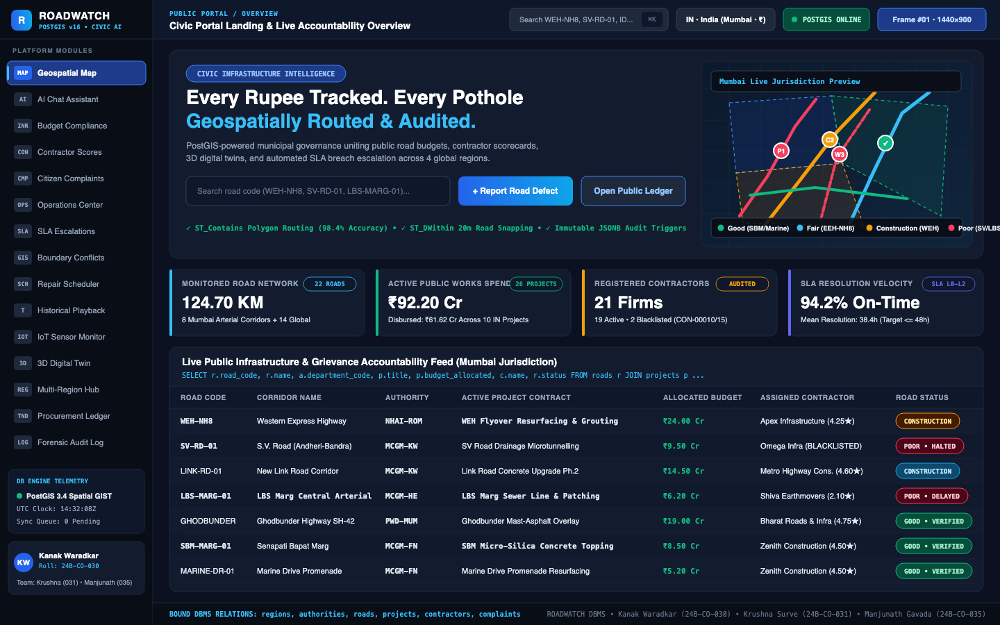

---

### Frame 02: Interactive Geospatial Road Registry Map & RoadDetailsPanel
* **Figma Frame ID:** `Frame_02_Geospatial_Road_Registry_Map` | **Viewport:** Desktop (`1440 x 900 px`)
* **Target Persona:** Citizens, Urban Planners, Ward Engineers inspecting specific road segments.
* **UI Architecture & Components:**
  * Full-bleed dark PostGIS vector map (`#0B1120`) rendering `WardsLayer` jurisdictional polygons (`BMC`, `MMRDA`, `MSRDC`) and color-coded `RoadsLayer` polylines (`GEOMETRY(LineString, 4326)`).
  * Floating `MapSearchBar` and `LayerControls` filter bar at top-left, plus a `MapLegend` overlay at bottom-left.
  * Open `RoadDetailsPanel` right-hand drawer (`450px` wide) inspecting **Swami Vivekananda Road (`SV-RD-01`)** with tabs for `Overview & Specs`, `Projects & Cost/KM (3)`, `Complaints (68)`, and `Contractors (2)`.
* **Database Binding:** Queries `roads` joined with `authorities`, `projects`, `contractors`, and `complaints` where `road_id = 'RD-IN-002'`.

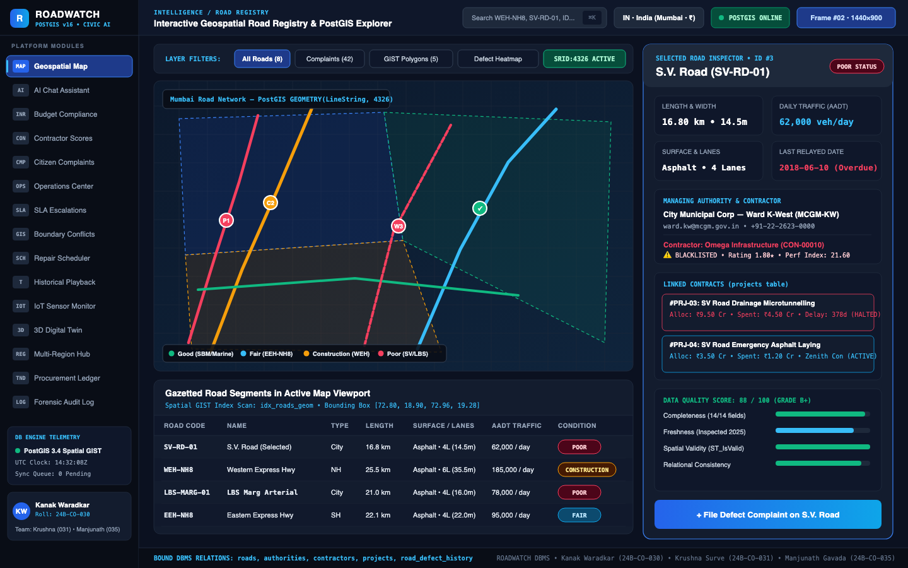

---

### Frame 03: Citizen Mobile Wizard Step 1 — GPS Pinpoint & PostGIS Auto-Snap
* **Figma Frame ID:** `Frame_03_Mobile_Wizard_Step1_GPS_Snap` | **Viewport:** Mobile (`390 x 844 px`)
* **Target Persona:** Commuter reporting a road hazard on-site via smartphone PWA.
* **UI Architecture & Components:**
  * 3-step wizard progress bar at Step 1 (`1. GPS & Snap`).
  * Interactive mobile dark GIS map centered on the user's live GPS fix (`19.1197 N, 72.8464 E`) with a blue target reticle and a dashed snap vector (`4.2m`) connecting the raw GPS coordinate to the `SV-RD-01` LineString centerline.
  * Bottom sheet card displaying the deterministic spatial resolution output: Auto-Snapped Road (`Swami Vivekananda Road`), Jurisdiction (`Brihanmumbai Municipal Corporation`), and Active Warranty Liability (`M/s Apex Roadbuilders`).
* **Database Binding:** Executes `ST_DWithin(roads.geom, ST_SetSRID(ST_MakePoint(lng, lat), 4326), 20.0)` and `ST_Contains(authorities.jurisdiction_geom, ST_SetSRID(ST_MakePoint(lng, lat), 4326))`.

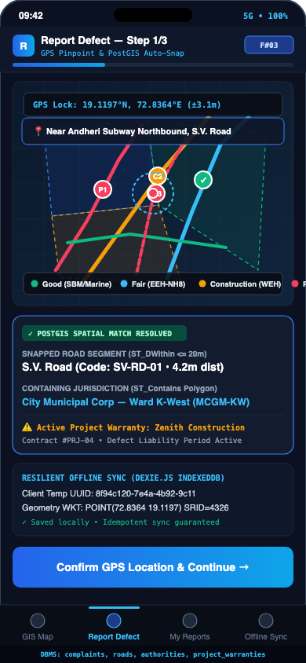

---

### Frame 04: Citizen Mobile Wizard Step 2 — Geotagged Photo & AI Vision Bounding Box Triage
* **Figma Frame ID:** `Frame_04_Mobile_Wizard_Step2_AI_Vision` | **Viewport:** Mobile (`390 x 844 px`)
* **Target Persona:** Commuter capturing visual proof of a pothole or structural failure.
* **UI Architecture & Components:**
  * Camera viewfinder displaying the asphalt defect with an EXIF GPS/timestamp watermark and two red/amber AI Vision bounding boxes (`pothole_cluster: 96.4%`, `edge_ravelling: 88.1%`).
  * AI Triage Assessment banner (`ai_Condition_Assessments`) recommending `CRITICAL` severity based on `9.5cm` estimated crater depth.
  * Defect category selector grid (`Pothole / Crater`, `Surface Cracking`, `Waterlogging`, `Open Manhole`, `Subsidence`, `Edge Erosion`) and 5-level severity segmented bar.
* **Database Binding:** Populates `complaints` (`defect_type`, `severity`, `photo_url`, `description`) and inserts telemetry into `ai_Condition_Assessments`.

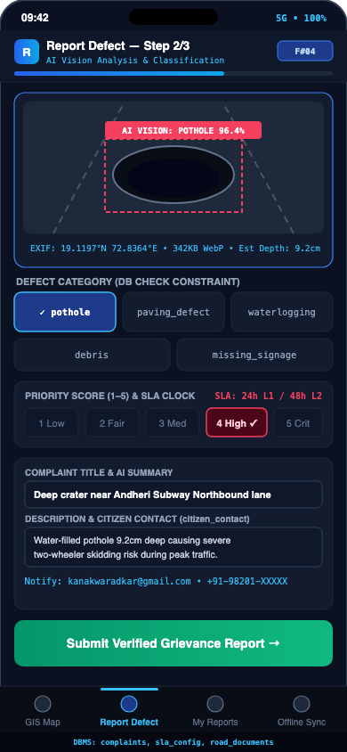

---

### Frame 05: Spatial Duplicate Check (`DuplicateComplaintDialog`) & Dexie.js Offline Sync
* **Figma Frame ID:** `Frame_05_Mobile_Duplicate_And_Offline_Sync` | **Viewport:** Mobile (`390 x 844 px`)
* **Target Persona:** Citizen submitting a defect in an area with existing reports or intermittent cellular connectivity.
* **UI Architecture & Components:**
  * `DuplicateComplaintDialog` warning banner triggered when PostGIS `ST_DWithin` detects an active complaint (`#CMP-00142`) within a `25-meter` radius on the same road segment.
  * Side-by-side action choice: `Upvote Existing #CMP-00142 (+1 Priority Boost)` vs. `Submit as Separate New Ticket`.
  * Local-first IndexedDB (`Dexie.js`) Offline Sync Queue card showing queued photo blobs and exponential backoff retry status (`synced` vs. `pending_retry`).
* **Database Binding:** Updates `complaints.upvote_count` or inserts a new row into `complaints` via idempotent client UUID sync.

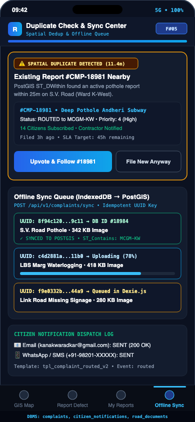

---

### Frame 06: Citizen "My Reports" Dashboard, SLA Countdown & Routing Verification
* **Figma Frame ID:** `Frame_06_Mobile_Citizen_SLA_Timeline` | **Viewport:** Mobile (`390 x 844 px`)
* **Target Persona:** Citizen tracking the resolution progress and statutory SLA deadline of submitted tickets.
* **UI Architecture & Components:**
  * Citizen summary strip (`14 Submitted`, `11 Resolved`, `2 In Progress`, `1 SLA Escalated`) and live SLA countdown badge (`06h 18m Left` out of `24h Critical SLA`).
  * 5-stage vertical `status_history` audit stepper tracing the ticket from `Submitted & Geo-Validated` to `Contractor Crew Dispatched`.
  * Interactive `RoutingFeedback` card asking the citizen to verify whether `BMC K-West Ward` is the correct authority (`routing_feedback` table).
* **Database Binding:** Queries `complaints` joined with `status_history`, `sla_config`, and `routing_feedback`.

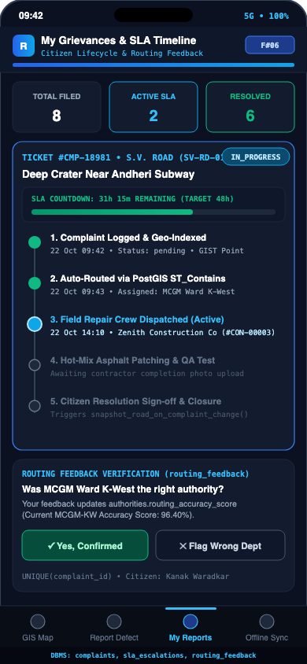

---

### Frame 07: AI Accountability Chat Assistant (`/chat`) & Automated Routing Cards
* **Figma Frame ID:** `Frame_07_AI_Accountability_Chat_RAG` | **Viewport:** Desktop (`1440 x 900 px`)
* **Target Persona:** Citizens, investigative journalists, and municipal auditors querying infrastructure accountability in natural language.
* **UI Architecture & Components:**
  * Left conversational thread with transparent SQL/PostGIS tool execution pills (`resolve_jurisdiction_postgis`, `query_road_warranty_and_projects`, `fetch_escalation_chain`) showing query execution latency.
  * Structured AI response table detailing contractor warranty liability (`CON-00001`), budget utilization (`Rs 40.10 Cr / Rs 38.50 Cr`), and defect density on `SV-RD-01`.
  * Right-hand live accountability panel containing the `RoutedToCard` (`authority_contacts`) and 3-tier `EscalationChainCard` (`escalation_rules`).
* **Database Binding:** Reads from `roads`, `projects`, `project_warranties`, `contractors`, `authorities`, `authority_contacts`, and `escalation_rules`.

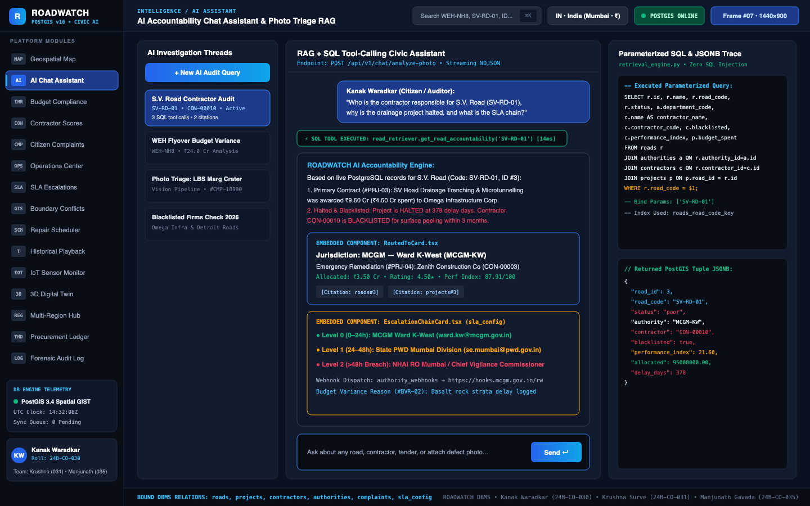

---

### Frame 08: 3D Digital Twin Inspection (`/twin`), Road Materials & Warranty Layer
* **Figma Frame ID:** `Frame_08_3D_Digital_Twin_Inspection` | **Viewport:** Desktop (`1440 x 900 px`)
* **Target Persona:** Structural Highway Engineers, Digital Twin Operators, Quality Assurance Inspectors.
* **UI Architecture & Components:**
  * Interactive 3D perspective corridor mesh of **Western Express Highway (`WEH-NH8`)** (`Three.js / WebGL`) with volumetric defect heatmaps (`CRACK-09`, `POTHOLE-14`) and camera orbit controls.
  * Left `RoadSelector` rail listing monitored corridors (`WEH-NH8`, `SV-RD-01`, `BWSL-01`, `LBS-01`) with live PCI scores.
  * Right-hand structural telemetry panel displaying the 4-layer pavement cross-section from `road_materials` (`SMA Wearing Course`, `DBM Base`, `Wet Mix Macadam`, `Granular Sub-Base`) and active `project_warranties` penalty status.
* **Database Binding:** Queries `roads`, `road_materials`, `project_warranties`, and `ai_Condition_Assessments`.

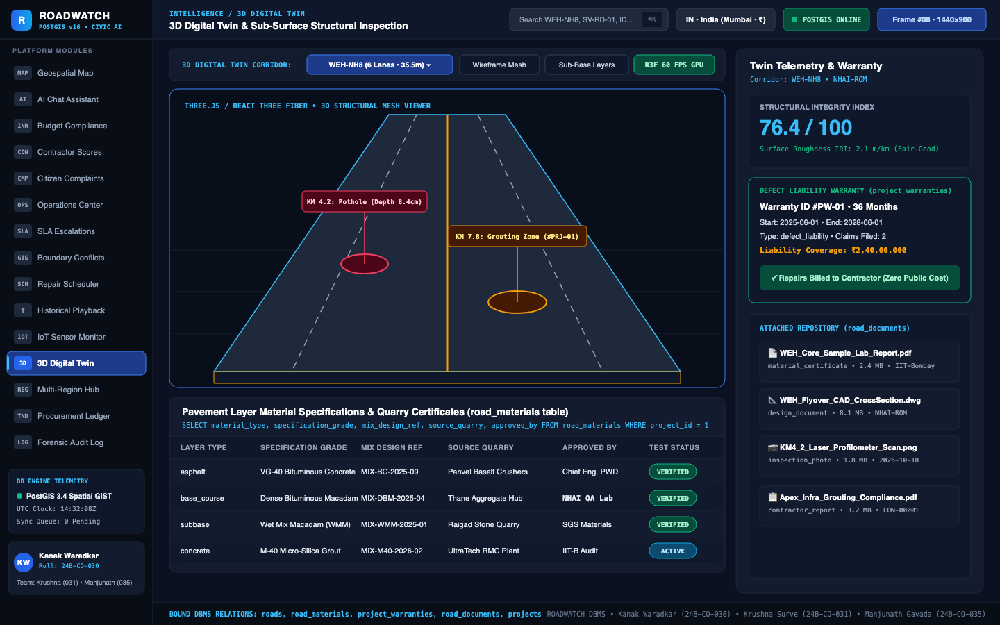

---

### Frame 09: IoT Pavement Sensor Network HUD, Underground Cross-Section & Telemetry
* **Figma Frame ID:** `Frame_09_IoT_Pavement_Sensor_Network` | **Viewport:** Desktop (`1440 x 900 px`)
* **Target Persona:** Smart City IoT Telemetry Engineers, Structural Maintenance Teams.
* **UI Architecture & Components:**
  * Top KPI strip summarizing `24 Embedded Nodes`, `18.4% Peak Sub-Base Moisture`, `4.42 G Peak Axle Vibration`, and `99.2% LoRaWAN Uplink Uptime`.
  * Left `UndergroundCrossSection` diagram showing physical sensor placement across asphalt and sub-base strata (`SEN-WEH-01` to `SEN-WEH-04`) alongside a 24-hour time-series anomaly chart (`sensor_Readings`).
  * Right-hand `iot_Sensors` hardware registry table with battery health, calibration dates, and alert thresholds.
* **Database Binding:** Queries `iot_Sensors` joined with time-series records in `sensor_Readings` and `road_materials`.

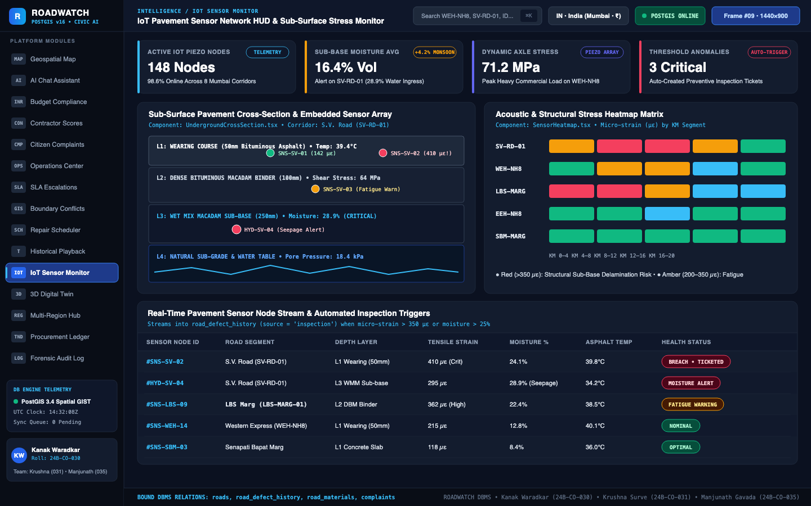

---

### Frame 10: Historical Deterioration Playback (`TimelineSlider` & `road_defect_history`)
* **Figma Frame ID:** `Frame_10_Historical_Deterioration_Playback` | **Viewport:** Desktop (`1440 x 900 px`)
* **Target Persona:** Highway Asset Planners, Forensic Pavement Auditors analyzing post-monsoon degradation.
* **UI Architecture & Components:**
  * Interactive 6-year `TimelineSlider` (`2021` to `2026`) with play/step controls and monsoon scrubbing markers.
  * Side-by-side longitudinal corridor comparison of `SV-RD-01` contrasting post-resurfacing baseline (`Oct 2022, PCI 91/100`) against current post-monsoon condition (`Oct 2026, PCI 48/100`).
  * Historical PCI decay curve plotted against cumulative monsoon rainfall and a bottom `road_defect_history` ledger linking recurring defects to warranty recovery claims.
* **Database Binding:** Queries `road_defect_history` joined with `roads`, `projects`, and `complaints`.

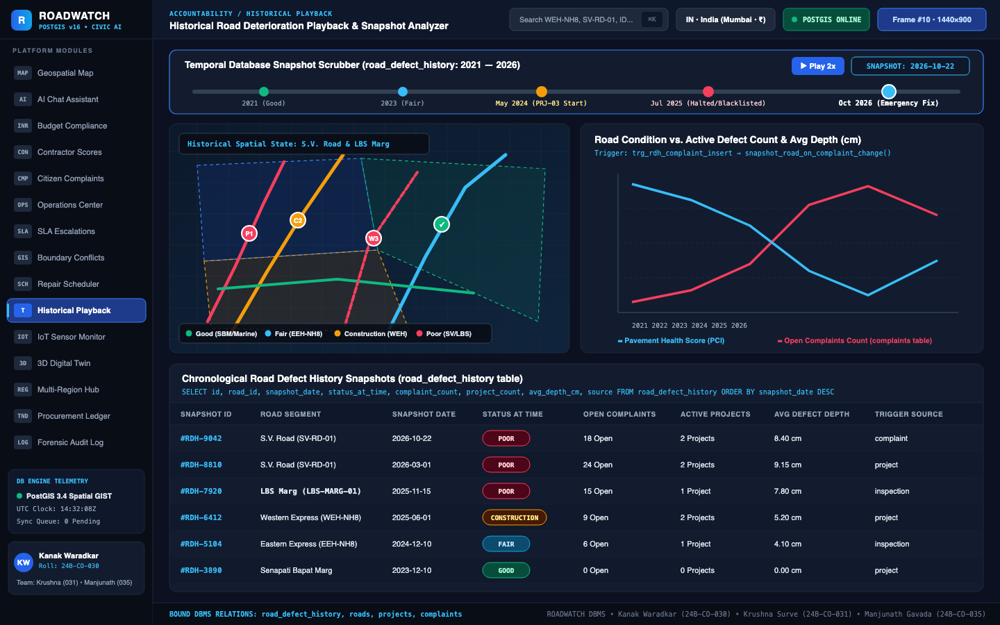

---

### Frame 11: Municipal Operations Command Center (`/operations`), Triage & Webhooks
* **Figma Frame ID:** `Frame_11_Municipal_Operations_Command` | **Viewport:** Desktop (`1440 x 900 px`)
* **Target Persona:** Municipal Grievance Dispatchers, Ward Control Room Operators.
* **UI Architecture & Components:**
  * Operational KPI header (`184 Open Queue`, `14 Critical Overdue`, `19.4h Mean Time to Repair`, `99.4% Webhook Delivery Rate`).
  * Multi-filter Grievance Triage Table displaying live SLA countdown timers, auto-routed authorities, and one-click `Dispatch` / `Escalate` actions.
  * Right-hand `authority_webhooks` endpoint health monitor and dark `LiveSystemLog` terminal streaming real-time PostGIS trigger and webhook events.
* **Database Binding:** Queries `complaints`, `authorities`, `authority_webhooks`, and `status_history`.

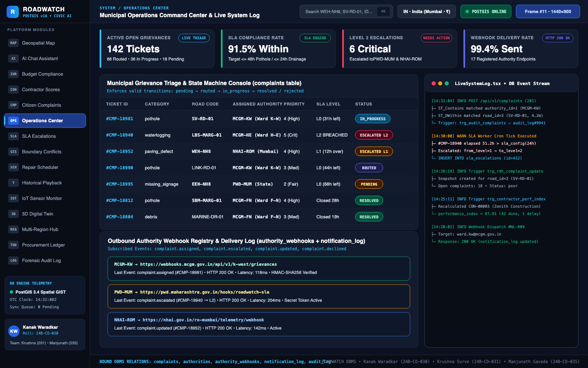

---

### Frame 12: Automated SLA Escalation Engine (`sla_config` & `sla_escalations`)
* **Figma Frame ID:** `Frame_12_Automated_SLA_Escalation_Engine` | **Viewport:** Desktop (`1440 x 900 px`)
* **Target Persona:** Chief Vigilance Officer, Municipal Commissioner, Ward Executive Engineers.
* **UI Architecture & Components:**
  * Left `sla_config` statutory matrix defining response, repair, and escalation windows across `CRITICAL (24h)`, `HIGH (48h)`, `MEDIUM (72h)`, and `LOW (168h)` severities, plus a visual 3-tier escalation pipeline (`L1 Ward JE -> L2 Executive Eng -> L3 Municipal Commissioner`).
  * Right-hand `sla_escalations` breach incident feed highlighting overdue tickets (`#CMP-00142`, `#CMP-00139`, `#CMP-00131`) with accrued contractor liquidated damages and `Force Contractor Penalty` controls.
* **Database Binding:** Queries `sla_config`, `sla_escalations`, `escalation_rules`, and `authority_contacts`.

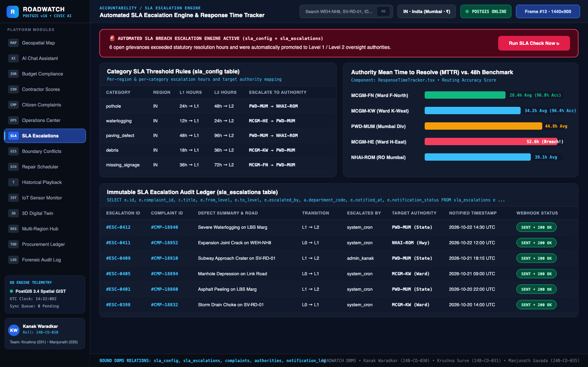

---

### Frame 13: Geospatial Jurisdiction Boundary & Conflict Resolver
* **Figma Frame ID:** `Frame_13_Geospatial_Conflict_Resolver` | **Viewport:** Desktop (`1440 x 900 px`)
* **Target Persona:** Municipal GIS Administrators, Inter-Agency Coordination Officers (`BMC` vs. `MMRDA` vs. `MSRDC`).
* **UI Architecture & Components:**
  * Split GIS conflict map illustrating overlapping authority polygon boundaries (`ST_Intersection`, `ST_Overlaps`) at the **Andheri Flyover Junction (`WEH-NH8` / `SV-RD-01`)** where MMRDA flyover deck jurisdiction intersects BMC surface slip-roads.
  * Right-hand `road_conflict_groups` adjudication console (`CFG-IN-001` to `CFG-IN-003`) and `road_aliases` / `road_region_crossings` canonical mapping table.
* **Database Binding:** Queries `road_conflict_groups`, `road_aliases`, `road_region_crossings`, `roads`, and `authorities`.

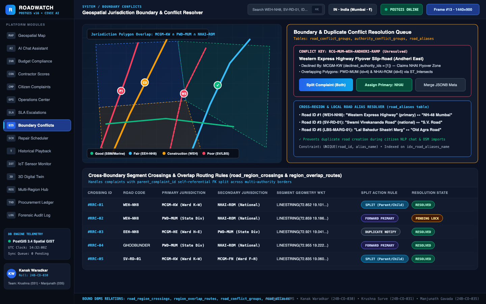

---

### Frame 14: Field Repair Gantt Scheduler & `project_milestones` Verification
* **Figma Frame ID:** `Frame_14_Field_Repair_Milestone_Scheduler` | **Viewport:** Desktop (`1440 x 900 px`)
* **Target Persona:** Project Executive Engineers, Field Auditors, Treasury Disbursement Officers.
* **UI Architecture & Components:**
  * Interactive 6-month Gantt timeline (`Jul 2026 - Dec 2026`) tracking `project_milestones` (`M1 Milling` through `M5 Final Core Audit`) for **PRJ-00012: S.V. Road Asphalt Resurfacing**.
  * Right-hand Field Inspector verification drawer displaying core sample laboratory test results (`51.2 mm` compacted thickness, `98.4%` Marshall density), dual digital signatures, and treasury payout authorization (`Rs 9.60 Cr`).
* **Database Binding:** Queries `projects` joined with `project_milestones`, `contractors`, and `authorities`.

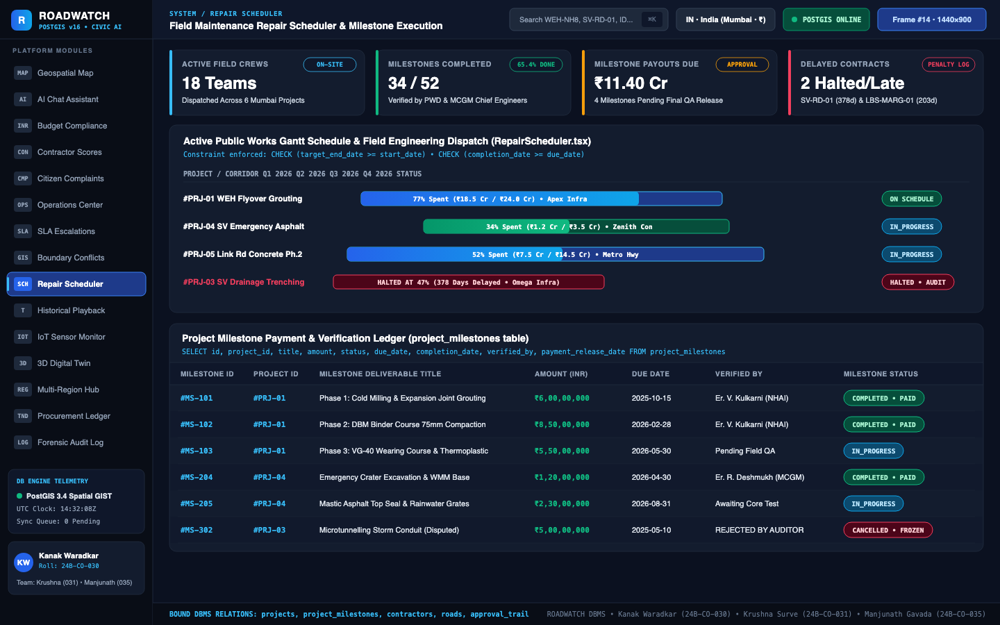

---

### Frame 15: Multi-Region Governance Hub (`IN`, `US`, `GB`, `KE`) & Data Catalog
* **Figma Frame ID:** `Frame_15_Multi_Region_Hub_Data_Catalog` | **Viewport:** Desktop (`1440 x 900 px`)
* **Target Persona:** Global Platform Administrators, Open-Data ETL Engineers.
* **UI Architecture & Components:**
  * 4 regional configuration cards (`IN - Mumbai`, `US - Detroit`, `GB - London`, `KE - Nairobi`) detailing localized currencies (`INR`, `USD`, `GBP`, `KES`), administrative hierarchies, and design standards (`IRC:37`, `AASHTO`, `DMRB`, `RDM`).
  * Left `region_import_log` GeoJSON/Shapefile ingestion pipeline history (`IMP-2026-089` to `IMP-2026-081`).
  * Right `cpi_data` inflation normalization table and `classification_Standards` cross-country road hierarchy equivalencies.
* **Database Binding:** Queries `regions`, `region_import_log`, `cpi_data`, and `classification_Standards`.

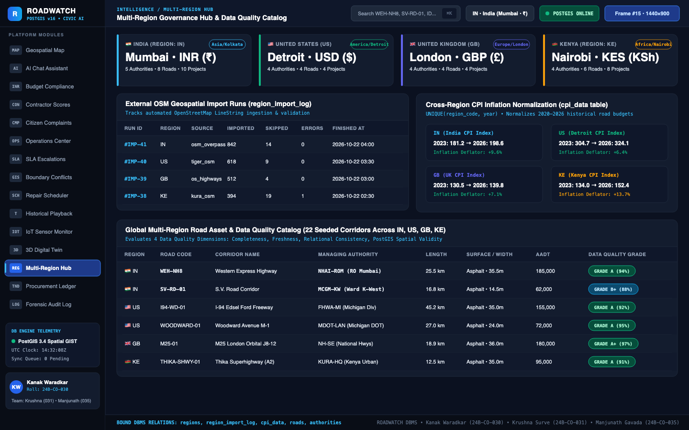

---

### Frame 16: Public Spend Transparency (`/ledger`), Sankey Flow & `cost_per_km_view`
* **Figma Frame ID:** `Frame_16_Public_Spend_Sankey_CostPerKM` | **Viewport:** Desktop (`1440 x 900 px`)
* **Target Persona:** Public Citizens, Fiscal Policy Analysts, Municipal Budget Committee.
* **UI Architecture & Components:**
  * Multi-stage `SankeyFlowVisualizer` tracing `Rs 412.8 Cr` from `fund_sources` (`BMC Capital Fund`, `MMRDA Infra Grant`, `World Bank Urban`) through `authorities` (`BMC`, `MMRDA`, `MSRDC`) to executing `contractors` (`Apex Infra`, `L&T Geo`, `Omega Infra`).
  * Right-hand `project_beneficiaries` socio-economic impact panel (`4.82M Daily Commuters`).
  * Bottom `cost_per_km_view` analytical table benchmarking CPI-adjusted `Cost / KM` against statutory highway class norms (`+53.5% CRITICAL OVERRUN` flagged on `LBS-01`).
* **Database Binding:** Queries `fund_sources`, `projects`, `cost_per_km_view`, `cpi_data`, and `project_beneficiaries`.

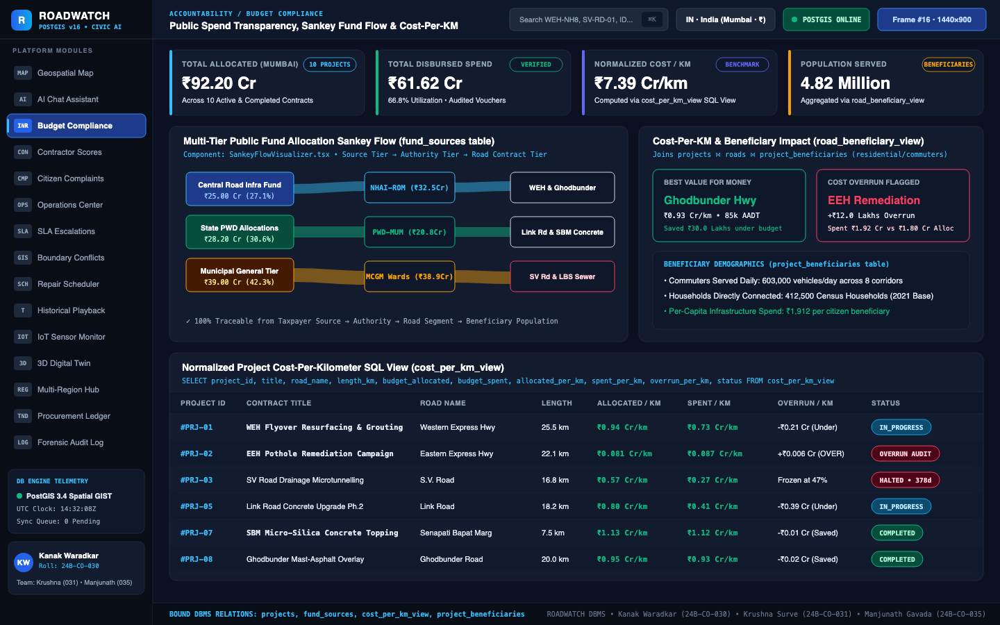

---

### Frame 17: Budget Variance Reasons, Contingency Reserves & `approval_trail`
* **Figma Frame ID:** `Frame_17_Budget_Variance_Approval_Trail` | **Viewport:** Desktop (`1440 x 900 px`)
* **Target Persona:** Comptroller and Auditor General (CAG) Auditors, Municipal Finance Committee.
* **UI Architecture & Components:**
  * Top variance summary KPI strip (`Rs 384.0 Cr Original Sanctioned`, `Rs 412.8 Cr Revised Actual`, `+Rs 28.8 Cr Net Variance`, `Rs 14.2 Cr Contingency Remaining`).
  * Left `budget_variance_reasons` itemization ledger (`BVR-0041` to `BVR-0032`) with forensic audit flags (`AUDIT QUERY` on `PRJ-00019` unverified rate escalation).
  * Right `approval_trail` multi-stage sign-off chain (`Junior Eng -> Executive Eng -> Chief Eng -> Standing Committee`) and `contingency_reserves` utilization gauge.
* **Database Binding:** Queries `budget_variance_reasons`, `contingency_reserves`, `approval_trail`, and `projects`.

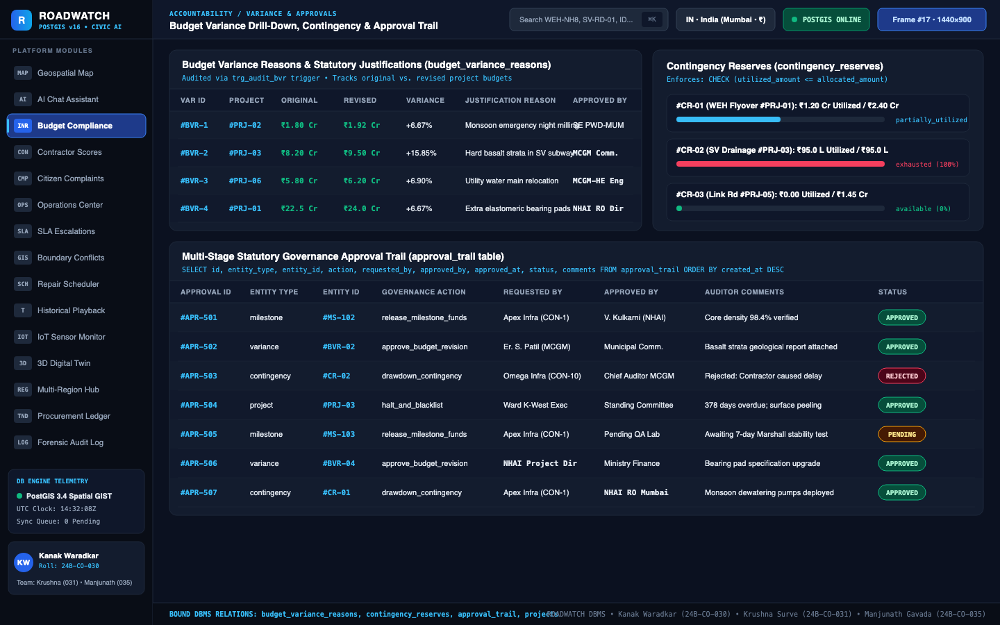

---

### Frame 18: Contractor Scorecards (`trg_contractor_perf_index`) & Blacklist Dossier
* **Figma Frame ID:** `Frame_18_Contractor_Scorecards_Blacklist` | **Viewport:** Desktop (`1440 x 900 px`)
* **Target Persona:** Municipal Procurement Board, Vigilance & Debarment Committee.
* **UI Architecture & Components:**
  * Top banner displaying the live PostgreSQL trigger formula (`trg_contractor_perf_index`) that automatically recalculates contractor grades whenever project milestones or warranty defects change.
  * Left `contractors` registry table ranking firms by `performance_index`, delay rate, and warranty defect recurrence.
  * Right-hand Debarment & Sanction Dossier for **M/s Omega Infrastructure (`CON-00010`)**, detailing `is_blacklisted = TRUE` enforcement, `Rs 4.20 Cr` surety bond forfeiture, and 6-axis radar scorecard comparison against `Apex Roadbuilders`.
* **Database Binding:** Queries `contractors`, `projects`, and `project_warranties`, governed by trigger `trg_contractor_perf_index`.

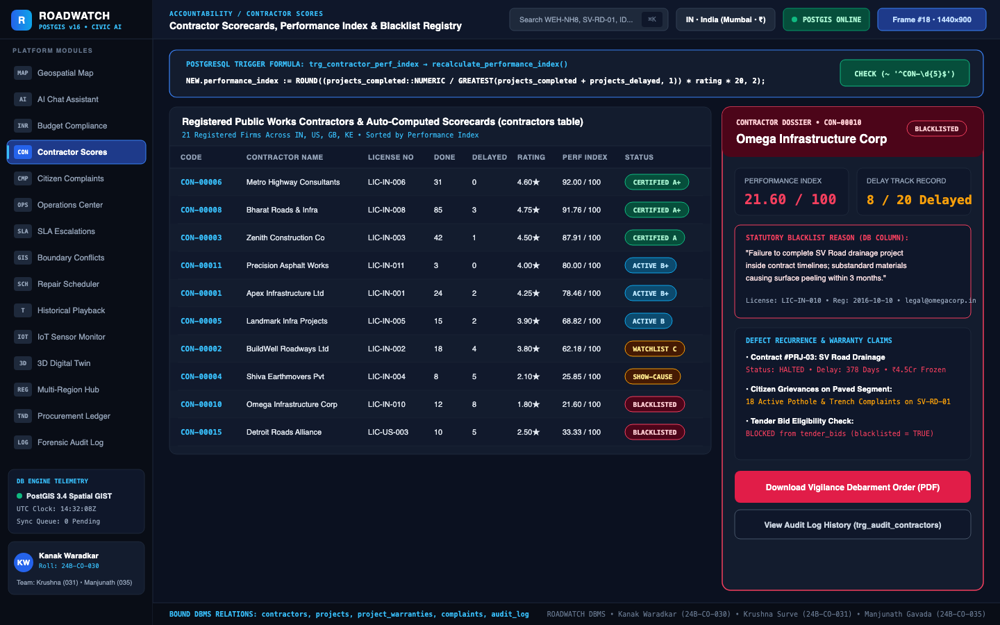

---

### Frame 19: Public Procurement Ledger (`tenders`, `tender_bids`, `evaluation_criteria`)
* **Figma Frame ID:** `Frame_19_Public_Procurement_Tenders_Matrix` | **Viewport:** Desktop (`1440 x 900 px`)
* **Target Persona:** Chief Tendering Officer, Technical & Financial Bid Evaluation Committee.
* **UI Architecture & Components:**
  * Active tender header for **TND-BMC-2026-042 (`S.V. Road Phase-II Full-Depth Reclamation`)** with `Rs 42.00 Cr` engineer estimate.
  * Left `tender_bids` L1/QCBS comparative evaluation matrix showing automated database trigger rejection (`REJECTED (DB TRIGGER)`) of blacklisted bidder `CON-00010` and `L1 WINNER` recommendation for `M/s Larsen & Toubro Geo (`CON-00002`)`.
  * Right `evaluation_criteria` weightage breakdown (`Technical 70% + Financial 30%`) and one-click `Authorize Award & Generate Project` workflow.
* **Database Binding:** Queries `tenders`, `tender_bids`, `evaluation_criteria`, and `contractors`.

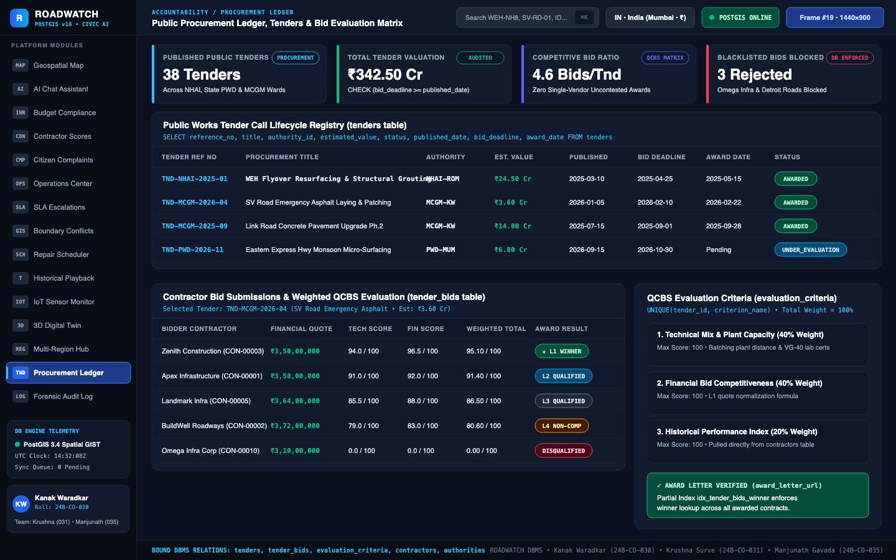

---

### Frame 20: Immutable PostgreSQL `audit_log` & Side-by-Side JSONB Diff Explorer
* **Figma Frame ID:** `Frame_20_Immutable_Database_Audit_Log` | **Viewport:** Desktop (`1440 x 900 px`)
* **Target Persona:** Database Administrators (DBAs), Forensic IT Auditors, Vigilance Investigators.
* **UI Architecture & Components:**
  * Top security banner confirming append-only `audit_log` enforcement (`REVOKE UPDATE, DELETE ON audit_log FROM PUBLIC`) via trigger `row_to_jsonb_audit()`.
  * Left chronological mutation table filtering `INSERT`, `UPDATE`, and `DELETE` events across `contractors`, `complaints`, `project_milestones`, and `budget_variance_reasons`.
  * Right-hand forensic JSONB payload inspector displaying a color-coded side-by-side diff (`old_data` in red vs. `new_data` in green) for `AUD-099482` (`CON-00010` blacklist enforcement) with `SHA-256` row hash verification.
* **Database Binding:** Queries the append-only `audit_log` table populated by `row_to_jsonb_audit()`.

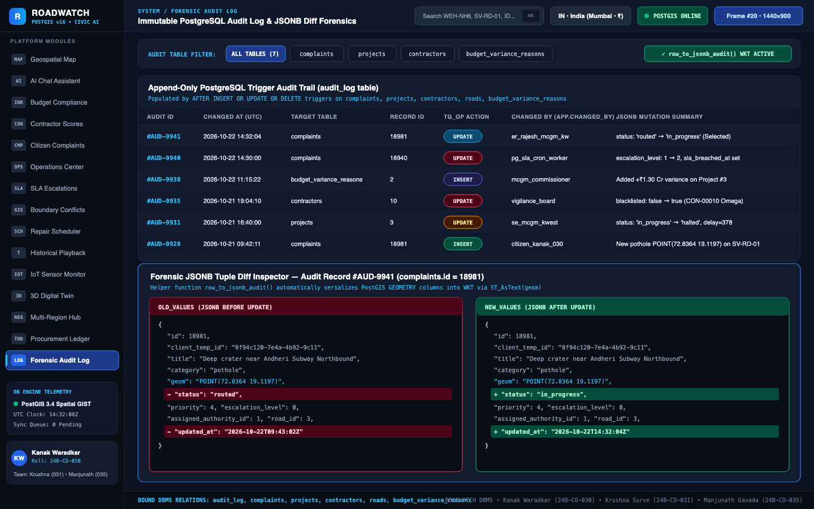

---

## 5. Importing the 20 Frames into Figma

All 20 frames have been generated as native, vector-editable SVG artboards (`1440 x 900` Desktop and `390 x 844` Mobile) that Figma natively parses into top-level **Figma Frames**, nested **Groups**, **Vector Paths**, and **Editable Text Layers**:

1. **Method 1 — Drag & Drop All 20 Frames at Once into Figma:**
   * Open your Figma design file (`https://www.figma.com`).
   * Drag and drop `DBMS_Project_Submission/ROADWATCH_All_20_Figma_Frames.svg` (or all 20 individual files inside `DBMS_Project_Submission/figma_frames/Frame_01_*.svg` to `Frame_20_*.svg`) directly onto the Figma canvas.
   * Figma immediately creates 20 properly named top-level Frames (`Frame_01_Civic_Portal_Landing_Hero` through `Frame_20_Immutable_Database_Audit_Log`) arranged in a 4-column design canvas grid.
2. **Method 2 — 1-Click Copy & Paste (`Cmd+V`) from Interactive Showcase:**
   * Open `DBMS_Project_Submission/wireframes/index.html` in any browser.
   * Click **Copy Frame SVG for Figma (`Cmd+V`)** on any screen (or **Copy All 20 Frames for Figma (`Cmd+V`)** in the top bar), switch to Figma, and press `Cmd+V` (`Ctrl+V`).
